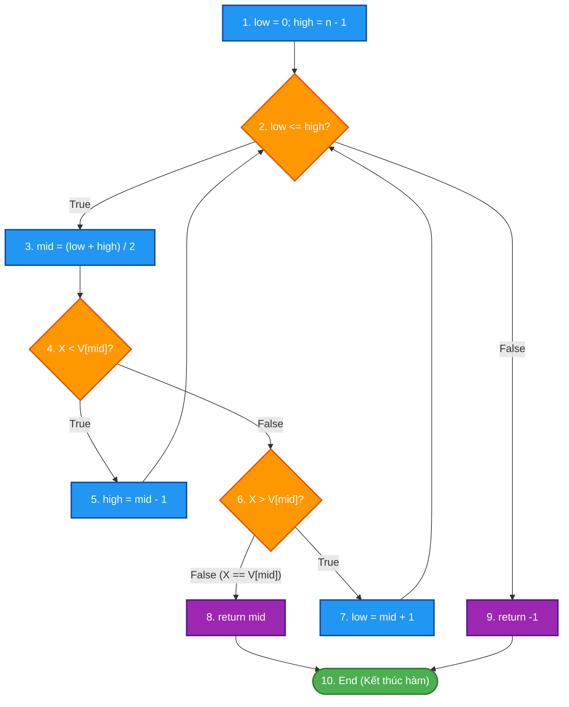
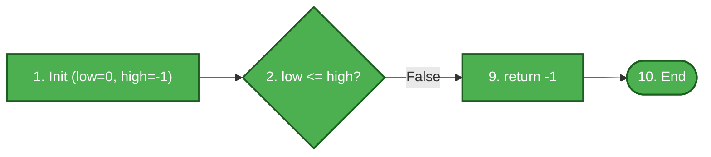
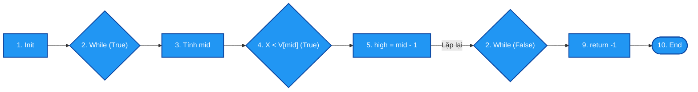
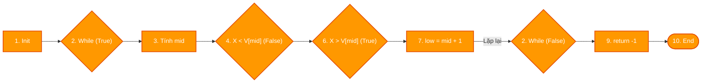
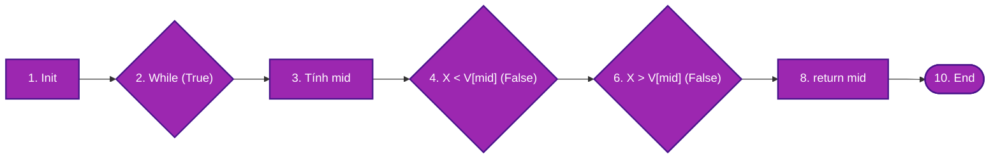

# ĐỀ THI GIỮA KỲ – MÔN KIỂM THỬ PHẦN MỀM

## **ĐỀ 01 – KỊCH BẢN 1**

### Thời gian: 60 phút | Được sử dụng tài liệu: Không

---

## CÂU 1 (6 ĐIỂM) – KIỂM THỬ HỘP ĐEN (Black-box Testing)

### Đặc tả bài toán: Hệ thống đặt phòng khách sạn trực tuyến

Một hệ thống đặt phòng khách sạn trực tuyến nhận đặt phòng dựa trên các quy tắc sau:

- **Số đêm lưu trú:** Tối thiểu **1 đêm**, tối đa **30 đêm**.
- **Số lượng khách:** Tối thiểu **1 người**, tối đa **4 người**.
- Nếu số đêm hoặc số khách nằm ngoài phạm vi trên → Hệ thống báo lỗi và từ chối đặt phòng.
- Nếu cả hai hợp lệ → Hệ thống xác nhận đặt phòng thành công và tính tổng chi phí theo bảng giá:

| Số đêm lưu trú | Giá mỗi đêm (VNĐ/phòng) |
| :-----------------: | :---------------------------: |
|    1 – 7 đêm    |            500.000            |
|    8 – 20 đêm    |            450.000            |
|   21 – 30 đêm   |            400.000            |

> **Ghi chú:** Mỗi phòng tối đa 4 khách. Chỉ đặt 1 phòng duy nhất.

---

### a. Áp dụng kỹ thuật Kiểm thử Lớp tương đương (3 điểm)

**Yêu cầu:**

1. Xác định các biến đầu vào và phân chia lớp tương đương hợp lệ / không hợp lệ.
2. Thiết kế bảng ca kiểm thử (Test Cases) tương ứng, đảm bảo mỗi lớp được bao phủ ít nhất một lần.

---

### b. Áp dụng kỹ thuật Kiểm thử Giá trị biên (3 điểm)

**Yêu cầu:**

1. Xác định các điểm biên cho từng biến đầu vào.
2. Thiết kế bảng ca kiểm thử (BVA Test Cases) cho tất cả các giá trị biên.

---

## CÂU 2 (4 ĐIỂM) – KIỂM THỬ HỘP TRẮNG (White-box Testing)

### Mã nguồn:

```c
int BinSearch(int X, int V[], int n)
{
    int low, high, mid;
    low = 0;
    high = n - 1;
    while (low <= high)
    {
        mid = (low + high) / 2;
        if (X < V[mid])
            high = mid - 1;
        else if (X > V[mid])
            low = mid + 1;
        else
            return mid;
    }
    return -1;
}
```

**Yêu cầu:**

1. Vẽ Đồ thị luồng điều khiển (CFG) của hàm trên. Đánh số nút rõ ràng.
2. Tính độ phức tạp Cyclomatic V(G) bằng hai công thức khác nhau.
3. Liệt kê các đường thi hành độc lập (Basis Paths).
4. Thiết kế bảng ca kiểm thử tương ứng cho từng đường thi hành (ghi rõ Input, đường đi qua các nút, kết quả mong đợi).

---

### Hết

---

---

# LỜI GIẢI CHI TIẾT – ĐỀ 01 KỊCH BẢN 1

---

## CÂU 1 – LỜI GIẢI (6 điểm)

### Xác định biến đầu vào

| Biến               | Ký hiệu | Miền giá trị hợp lệ           |
| :------------------ | :-------- | :--------------------------------- |
| Số đêm lưu trú | D         | 1 ≤ D ≤ 30 (số nguyên dương) |
| Số lượng khách  | K         | 1 ≤ K ≤ 4 (số nguyên dương)  |

---

### a. Kiểm thử Lớp tương đương (3 điểm)

#### Bước 1: Phân chia lớp tương đương

| Biến đầu vào | Lớp tương đương hợp lệ                    | Lớp tương đương không hợp lệ                     |
| :--------------- | :------------------------------------------------ | :-------------------------------------------------------- |
| Số đêm (D)    | **EC1:** 1 ≤ D ≤ 7 (giá 500.000/đêm)   | **EC5:** D < 1 (số đêm âm hoặc bằng 0)        |
|                  | **EC2:** 8 ≤ D ≤ 20 (giá 450.000/đêm)  | **EC6:** D > 30 (quá giới hạn)                   |
|                  | **EC3:** 21 ≤ D ≤ 30 (giá 400.000/đêm) | **EC7:** D không phải số nguyên (ký tự, chữ) |
| Số khách (K)   | **EC4:** 1 ≤ K ≤ 4                        | **EC8:** K < 1                                      |
|                  |                                                   | **EC9:** K > 4                                      |
|                  |                                                   | **EC10:** K không phải số nguyên                |

#### Bước 2: Bảng ca kiểm thử Lớp tương đương

|     TC ID     | Mục đích                           | Số đêm (D) | Số khách (K) | Lớp bao phủ | Kết quả mong đợi                                    |
| :------------: | :------------------------------------ | :-----------: | :------------: | :-----------: | :------------------------------------------------------ |
| **TC01** | Đặt phòng ngắn hạn (1–7 đêm)  |       3       |       2       |   EC1, EC4   | Thành công. Chi phí: 3 × 500.000 = 1.500.000 VNĐ   |
| **TC02** | Đặt phòng trung hạn (8–20 đêm) |      10      |       1       |   EC2, EC4   | Thành công. Chi phí: 10 × 450.000 = 4.500.000 VNĐ  |
| **TC03** | Đặt phòng dài hạn (21–30 đêm) |      25      |       3       |   EC3, EC4   | Thành công. Chi phí: 25 × 400.000 = 10.000.000 VNĐ |
| **TC04** | Số đêm bằng 0 (không hợp lệ)   |       0       |       2       |   EC5, EC4   | Báo lỗi: "Số đêm tối thiểu là 1"                |
| **TC05** | Số đêm âm (không hợp lệ)       |      -5      |       2       |   EC5, EC4   | Báo lỗi: "Số đêm không hợp lệ"                  |
| **TC06** | Số đêm vượt quá 30              |      35      |       2       |   EC6, EC4   | Báo lỗi: "Số đêm tối đa là 30"                  |
| **TC07** | Số đêm là ký tự chữ            |     "abc"     |       2       |   EC7, EC4   | Báo lỗi: "Vui lòng nhập số nguyên"                |
| **TC08** | Số khách bằng 0                    |       5       |       0       |   EC1, EC8   | Báo lỗi: "Số khách tối thiểu là 1"               |
| **TC09** | Số khách vượt quá 4              |       5       |       6       |   EC1, EC9   | Báo lỗi: "Số khách tối đa là 4"                  |
| **TC10** | Số khách là ký tự                |       5       |     "xyz"     |   EC1, EC10   | Báo lỗi: "Vui lòng nhập số nguyên"                |

---

### b. Kiểm thử Giá trị biên (3 điểm)

#### Bước 1: Xác định các điểm biên

- **Biến Số đêm (D):** Miền [1, 30], điểm phân chia nội bộ tại 7 và 20.

  - Biên tại 1: {0, 1, 2}
  - Biên tại 7/8 (phân chia lớp): {6, 7, 8}
  - Biên tại 20/21 (phân chia lớp): {19, 20, 21}
  - Biên tại 30: {29, 30, 31}
- **Biến Số khách (K):** Miền [1, 4].

  - Biên tại 1: {0, 1, 2}
  - Biên tại 4: {3, 4, 5}

#### Bước 2: Bảng ca kiểm thử Giá trị biên

|      TC ID      | Mô tả                                        | D | K | Kết quả mong đợi                          |
| :-------------: | :--------------------------------------------- | :-: | :-: | :-------------------------------------------- |
| **BVA01** | Dưới biên tối thiểu số đêm             | 0 | 2 | Lỗi: Số đêm không hợp lệ               |
| **BVA02** | Biên tối thiểu số đêm                    | 1 | 2 | Thành công. 1 × 500.000 = 500.000 VNĐ     |
| **BVA03** | Ngay trên biên tối thiểu số đêm         | 2 | 2 | Thành công. 2 × 500.000 = 1.000.000 VNĐ   |
| **BVA04** | Ngay dưới biên phân chia 7/8               | 6 | 2 | Thành công. 6 × 500.000 = 3.000.000 VNĐ   |
| **BVA05** | Tại biên 7 đêm                             | 7 | 2 | Thành công. 7 × 500.000 = 3.500.000 VNĐ   |
| **BVA06** | Ngay trên biên 7 (chuyển sang lớp 8–20)   | 8 | 2 | Thành công. 8 × 450.000 = 3.600.000 VNĐ   |
| **BVA07** | Ngay dưới biên phân chia 20/21             | 19 | 2 | Thành công. 19 × 450.000 = 8.550.000 VNĐ  |
| **BVA08** | Tại biên 20 đêm                            | 20 | 2 | Thành công. 20 × 450.000 = 9.000.000 VNĐ  |
| **BVA09** | Ngay trên biên 20 (chuyển sang lớp 21–30) | 21 | 2 | Thành công. 21 × 400.000 = 8.400.000 VNĐ  |
| **BVA10** | Ngay dưới biên tối đa số đêm           | 29 | 2 | Thành công. 29 × 400.000 = 11.600.000 VNĐ |
| **BVA11** | Biên tối đa số đêm                       | 30 | 2 | Thành công. 30 × 400.000 = 12.000.000 VNĐ |
| **BVA12** | Vượt biên tối đa số đêm                | 31 | 2 | Lỗi: Số đêm tối đa là 30               |
| **BVA13** | Dưới biên tối thiểu số khách            | 5 | 0 | Lỗi: Số khách không hợp lệ              |
| **BVA14** | Biên tối thiểu số khách                   | 5 | 1 | Thành công. 5 × 500.000 = 2.500.000 VNĐ   |
| **BVA15** | Ngay trên biên tối thiểu số khách        | 5 | 2 | Thành công. 5 × 500.000 = 2.500.000 VNĐ   |
| **BVA16** | Ngay dưới biên tối đa số khách          | 5 | 3 | Thành công. 5 × 500.000 = 2.500.000 VNĐ   |
| **BVA17** | Biên tối đa số khách                      | 5 | 4 | Thành công. 5 × 500.000 = 2.500.000 VNĐ   |
| **BVA18** | Vượt biên tối đa số khách               | 5 | 5 | Lỗi: Số khách tối đa là 4               |

---

## CÂU 2 – LỜI GIẢI (4 điểm)

### Bước 1: Đánh số câu lệnh và xác định các nút trong Đồ thị luồng điều khiển (CFG)

Mã nguồn hàm `BinSearch(int X, int V[], int n)` được phân tách thành các khối lệnh và nút đồ thị như sau:
- **Nút 1:** `low = 0; high = n - 1;` (Khởi tạo 2 con trỏ tìm kiếm)
- **Nút 2:** `while (low <= high)` (Vị từ kiểm tra điều kiện lặp)
- **Nút 3:** `mid = (low + high) / 2;` (Tính vị trí phần tử nằm giữa)
- **Nút 4:** `if (X < V[mid])` (Vị từ rẽ nhánh 1: kiểm tra nửa trái)
- **Nút 5:** `high = mid - 1;` (Thu hẹp không gian tìm kiếm sang nửa trái)
- **Nút 6:** `else if (X > V[mid])` (Vị từ rẽ nhánh 2: kiểm tra nửa phải)
- **Nút 7:** `low = mid + 1;` (Thu hẹp không gian tìm kiếm sang nửa phải)
- **Nút 8:** `return mid;` (Tìm thấy phần tử $X$, trả về chỉ số)
- **Nút 9:** `return -1;` (Không tìm thấy sau khi xét hết mảng)
- **Nút 10:** `End / Exit` (Điểm kết thúc hàm)

---

### Sơ đồ Đồ thị luồng điều khiển (CFG) tổng quát



---

### Bước 2: Tính độ phức tạp Cyclomatic $V(G)$

Thống kê các thành phần của đồ thị luồng điều khiển $G$:
- **Số nút ($N$):** $10$ (từ Nút 1 đến Nút 10)
- **Số cung ($E$):** $12$
  - Các cung gồm: $(1\to2)$, $(2\to3)$, $(2\to9)$, $(3\to4)$, $(4\to5)$, $(4\to6)$, $(5\to2)$, $(6\to7)$, $(6\to8)$, $(7\to2)$, $(8\to10)$, $(9\to10)$
- **Số nút vị từ phân nhánh ($P$):** $3$ nút điều kiện có 2 nhánh rẽ (Nút 2, Nút 4, Nút 6)

Áp dụng 2 công thức chuẩn:
- **Công thức 1 (Dựa vào số cung và số nút):**
  $$V(G) = E - N + 2 = 12 - 10 + 2 = 4$$
- **Công thức 2 (Dựa vào số nút vị từ):**
  $$V(G) = P + 1 = 3 + 1 = 4$$

*(Kiểm chứng thêm theo số miền phẳng $R$: Đồ thị tạo ra 3 miền khép kín $R_1, R_2, R_3$ và 1 miền mở vô hạn bên ngoài $R_4 \implies V(G) = R = 4$)*.

> **Kết luận:** Độ phức tạp Cyclomatic $V(G) = 4$. Cần tối thiểu **4 đường thi hành cơ sở (Basis Paths)** độc lập tuyến tính để bao phủ kiểm thử.

---

### Bước 3: Sơ đồ hóa các đường thi hành cơ sở (Basis Paths)

Mỗi đường thi hành độc lập được biểu diễn thành sơ đồ luồng riêng biệt:

#### 🔹 Đường 1 (P1): Mảng rỗng hoặc không thỏa mãn điều kiện lặp ngay từ đầu
- **Đường đi:** $1 \to 2(\text{False}) \to 9 \to 10$
- **Đặc điểm:** Vòng `while` lặp 0 lần; kết thúc trả về `-1`.



#### 🔹 Đường 2 (P2): Tìm kiếm về nhánh trái ($X < V[mid]$)
- **Đường đi:** $1 \to 2(\text{True}) \to 3 \to 4(\text{True}) \to 5 \to 2(\text{False}) \to 9 \to 10$
- **Đặc điểm:** Bao phủ nhánh `True` của Nút 4; giảm biên trên `high = mid - 1`; lặp lại cho tới khi kết thúc không thấy phần tử.



#### 🔹 Đường 3 (P3): Tìm kiếm về nhánh phải ($X > V[mid]$)
- **Đường đi:** $1 \to 2(\text{True}) \to 3 \to 4(\text{False}) \to 6(\text{True}) \to 7 \to 2(\text{False}) \to 9 \to 10$
- **Đặc điểm:** Bao phủ nhánh `False` của Nút 4 và nhánh `True` của Nút 6; tăng biên dưới `low = mid + 1`; lặp lại cho tới khi kết thúc không thấy phần tử.



#### 🔹 Đường 4 (P4): Tìm thấy phần tử đích ($X == V[mid]$)
- **Đường đi:** $1 \to 2(\text{True}) \to 3 \to 4(\text{False}) \to 6(\text{False}) \to 8 \to 10$
- **Đặc điểm:** Bao phủ nhánh `False` của cả Nút 4 và Nút 6; lập tức trả về chỉ số `mid` và kết thúc hàm thành công.



---

### Bước 4: Ma trận bao phủ các cung (Branch / Edge Coverage Matrix)

| Cung (Edge) | Nhãn nhánh | P1 | P2 | P3 | P4 | Mức độ bao phủ |
|:---:|:---|:---:|:---:|:---:|:---:|:---:|
| **e1** ($1 \to 2$) | Khởi tạo vào vòng lặp | ✓ | ✓ | ✓ | ✓ | 100% |
| **e2** ($2 \to 3$) | Điều kiện while = True | | ✓ | ✓ | ✓ | 100% |
| **e3** ($2 \to 9$) | Điều kiện while = False | ✓ | ✓ | ✓ | | 100% |
| **e4** ($3 \to 4$) | Chuyển đến kiểm tra nhánh 1 | | ✓ | ✓ | ✓ | 100% |
| **e5** ($4 \to 5$) | Nhánh `X < V[mid]` = True | | ✓ | | | 100% |
| **e6** ($4 \to 6$) | Nhánh `X < V[mid]` = False | | | ✓ | ✓ | 100% |
| **e7** ($5 \to 2$) | Vòng lặp quay lại từ nhánh trái | | ✓ | | | 100% |
| **e8** ($6 \to 7$) | Nhánh `X > V[mid]` = True | | | ✓ | | 100% |
| **e9** ($6 \to 8$) | Nhánh `X > V[mid]` = False | | | | ✓ | 100% |
| **e10** ($7 \to 2$) | Vòng lặp quay lại từ nhánh phải | | | ✓ | | 100% |
| **e11** ($8 \to 10$) | Kết thúc sau khi tìm thấy | | | | ✓ | 100% |
| **e12** ($9 \to 10$) | Kết thúc sau khi duyệt hết | ✓ | ✓ | ✓ | | 100% |

---

### Bước 5: Bảng ca kiểm thử hộp trắng (White-box Test Cases)

Giả sử mảng kiểm thử mẫu gồm 5 phần tử đã sắp xếp: $V = [2, 5, 8, 12, 16]$, kích thước $n = 5$.

| TC ID | Mục tiêu kiểm thử | Dữ liệu đầu vào (Input) | Luồng thực thi qua các nút | Số lần lặp While | Kết quả mong đợi | Tiêu chí bao phủ đạt được |
|:---:|:---|:---|:---|:---:|:---|:---:|
| **TC_P1** | Bao phủ đường P1 (Vòng lặp không chạy, mảng rỗng) | $X = 5$<br>$V = []$<br>$n = 0$ | $1 \to 2(F) \to 9 \to 10$ | 0 | `return -1`<br>(Không tìm thấy) | Phủ nhánh False của Nút 2, câu lệnh Nút 9 |
| **TC_P2** | Bao phủ đường P2 (Tìm kiếm nhánh trái, giá trị nhỏ hơn min) | $X = 1$<br>$V = [2, 5, 8, 12, 16]$<br>$n = 5$ | $1 \to [2(T) \to 3 \to 4(T) \to 5] \to 2(F) \to 9 \to 10$ | 3 lần lặp (thu nửa trái liên tục) | `return -1`<br>(Không tìm thấy) | Phủ nhánh True của Nút 4, cung $5 \to 2$ |
| **TC_P3** | Bao phủ đường P3 (Tìm kiếm nhánh phải, giá trị lớn hơn max) | $X = 20$<br>$V = [2, 5, 8, 12, 16]$<br>$n = 5$ | $1 \to [2(T) \to 3 \to 4(F) \to 6(T) \to 7] \to 2(F) \to 9 \to 10$ | 2 lần lặp (thu nửa phải liên tục) | `return -1`<br>(Không tìm thấy) | Phủ nhánh True của Nút 6, cung $7 \to 2$ |
| **TC_P4** | Bao phủ đường P4 (Tìm thấy phần tử ngay tại vị trí giữa) | $X = 8$<br>$V = [2, 5, 8, 12, 16]$<br>$n = 5$ | $1 \to 2(T) \to 3 \to 4(F) \to 6(F) \to 8 \to 10$ | 1 lần lặp (trúng ngay tại `mid = 2`) | `return 2`<br>(Chỉ số của 8 trong $V$) | Phủ nhánh False của Nút 6, câu lệnh Nút 8, cung $8 \to 10$ |

---

> **Tổng kết thang điểm đạt được:**
> - **Vẽ sơ đồ CFG:** 1.0 điểm – Đầy đủ nút, nhánh rẽ điều kiện, mũi tên lặp và điểm kết thúc rõ ràng.
> - **Tính Cyclomatic Complexity $V(G)$:** 1.0 điểm – Trình bày đủ 2 công thức $E - N + 2$ và $P + 1$ đều bằng 4.
> - **Liệt kê và sơ đồ hóa các Basis Paths:** 1.0 điểm – 4 đường cơ sở có sơ đồ minh họa luồng thực thi trực quan.
> - **Thiết kế bảng Ca kiểm thử (Test Cases):** 1.0 điểm – Input cụ thể, vết luồng đi qua các nút và kết quả mong đợi chính xác.
