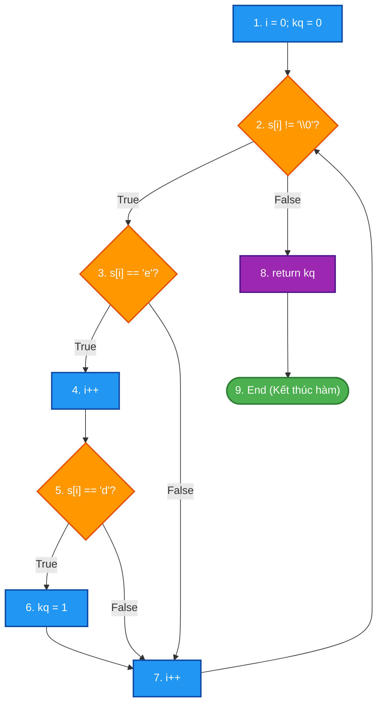
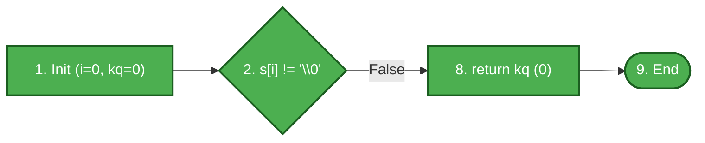
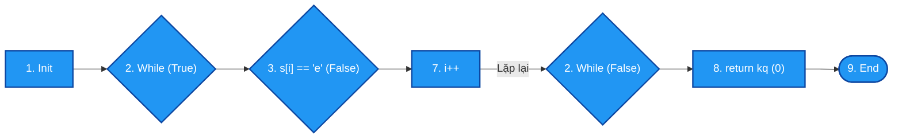
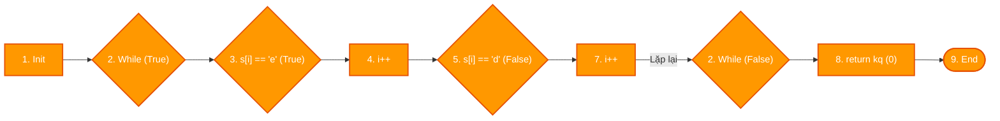
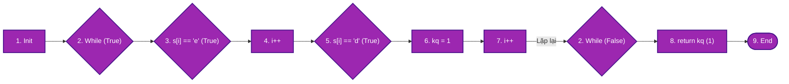

# ĐỀ THI GIỮA KỲ – MÔN KIỂM THỬ PHẦN MỀM
## **ĐỀ 02 – KỊCH BẢN 1**
### Thời gian: 60 phút | Được sử dụng tài liệu: Không

---

## CÂU 1 (6 ĐIỂM) – KIỂM THỬ HỘP ĐEN (Black-box Testing)

### Đặc tả bài toán: Hệ thống tính phí giao dịch ngân hàng trực tuyến

Một ngân hàng áp dụng quy tắc tính phí giao dịch chuyển tiền trực tuyến như sau:

- **Số tiền giao dịch hợp lệ:** Tối thiểu **10.000 VNĐ**, tối đa **500.000.000 VNĐ**.
- Nếu số tiền nằm ngoài phạm vi trên → Hệ thống từ chối và báo lỗi.
- Nếu hợp lệ → Hệ thống tính phí theo bảng sau:

| Số tiền giao dịch | Phí giao dịch |
|:--|:--|
| 10.000 đến dưới 1.000.000 VNĐ | 5.000 VNĐ (cố định) |
| 1.000.000 đến 10.000.000 VNĐ | 10.000 VNĐ (cố định) |
| Trên 10.000.000 VNĐ | 0,1% số tiền giao dịch |

- **Số tài khoản nhận:** Phải là chuỗi số gồm đúng **10 hoặc 14 chữ số** (không chứa chữ cái hay ký tự đặc biệt).

---

### a. Áp dụng kỹ thuật Kiểm thử Lớp tương đương (3 điểm)

**Yêu cầu:**
1. Xác định các biến đầu vào và phân chia lớp tương đương hợp lệ / không hợp lệ cho từng biến.
2. Thiết kế bảng ca kiểm thử (Test Cases) tương ứng, đảm bảo mỗi lớp được bao phủ ít nhất một lần.

---

### b. Áp dụng kỹ thuật Kiểm thử Giá trị biên (3 điểm)

**Yêu cầu:**
1. Xác định các điểm biên cho biến **Số tiền giao dịch**.
2. Thiết kế bảng ca kiểm thử (BVA Test Cases) cho tất cả các giá trị biên đã xác định.

---

## CÂU 2 (4 ĐIỂM) – KIỂM THỬ HỘP TRẮNG (White-box Testing)

### Mã nguồn:

```c
int check_d_after_e(char s[])
{
    int i = 0;
    int kq = 0;
    while (s[i] != '\0')
    {
        if (s[i] == 'e')
        {
            i++;
            if (s[i] == 'd')
                kq = 1;
        }
        i++;
    }
    return kq;
}
```

**Yêu cầu:**
1. Vẽ Đồ thị luồng điều khiển (CFG) của hàm trên. Đánh số nút rõ ràng.
2. Tính độ phức tạp Cyclomatic V(G) bằng hai công thức khác nhau.
3. Liệt kê các đường thi hành độc lập (Basis Paths).
4. Thiết kế bảng ca kiểm thử tương ứng cho từng đường thi hành (ghi rõ Input, đường đi qua các nút, kết quả mong đợi).

---

### Hết

---
---

# LỜI GIẢI CHI TIẾT – ĐỀ 02 KỊCH BẢN 1

---

## CÂU 1 – LỜI GIẢI (6 điểm)

### Xác định biến đầu vào

| Biến | Ký hiệu | Miền giá trị hợp lệ |
|:--|:--|:--|
| Số tiền giao dịch | T | 10.000 ≤ T ≤ 500.000.000 (VNĐ, số nguyên dương) |
| Số tài khoản nhận | STK | Chuỗi số nguyên, độ dài đúng 10 hoặc 14 ký tự |

---

### a. Kiểm thử Lớp tương đương (3 điểm)

#### Bước 1: Phân chia lớp tương đương

| Biến đầu vào | Lớp hợp lệ | Lớp không hợp lệ |
|:--|:--|:--|
| Số tiền (T) | **EC1:** 10.000 ≤ T < 1.000.000 → phí 5.000 VNĐ | **EC6:** T < 10.000 |
| | **EC2:** 1.000.000 ≤ T ≤ 10.000.000 → phí 10.000 VNĐ | **EC7:** T > 500.000.000 |
| | **EC3:** T > 10.000.000 → phí 0,1% | **EC8:** T không phải số (chữ, ký tự đặc biệt) |
| Số tài khoản (STK) | **EC4:** Đúng 10 chữ số | **EC9:** Độ dài khác 10 và 14 (vd: 9, 11, 13 số) |
| | **EC5:** Đúng 14 chữ số | **EC10:** Chứa chữ cái hoặc ký tự đặc biệt |

#### Bước 2: Bảng ca kiểm thử Lớp tương đương

| TC ID | Mục đích | Số tiền (T) | Số TK | Lớp bao phủ | Kết quả mong đợi |
|:--:|:--|:--:|:--:|:--:|:--|
| **TC01** | Phí cố định 5.000đ | 500.000 | 0123456789 | EC1, EC4 | Thành công. Phí: 5.000 VNĐ |
| **TC02** | Phí cố định 10.000đ | 5.000.000 | 0123456789 | EC2, EC4 | Thành công. Phí: 10.000 VNĐ |
| **TC03** | Phí 0,1% | 50.000.000 | 01234567890123 | EC3, EC5 | Thành công. Phí: 50.000 VNĐ |
| **TC04** | STK 14 chữ số hợp lệ | 500.000 | 01234567890123 | EC1, EC5 | Thành công. Phí: 5.000 VNĐ |
| **TC05** | Số tiền quá nhỏ | 5.000 | 0123456789 | EC6 | Lỗi: Số tiền tối thiểu 10.000 VNĐ |
| **TC06** | Số tiền quá lớn | 600.000.000 | 0123456789 | EC7 | Lỗi: Số tiền vượt hạn mức |
| **TC07** | Số tiền không phải số | "abc" | 0123456789 | EC8 | Lỗi: Số tiền không hợp lệ |
| **TC08** | STK sai độ dài (9 số) | 500.000 | 012345678 | EC1, EC9 | Lỗi: Số tài khoản không hợp lệ |
| **TC09** | STK chứa chữ cái | 500.000 | 012345678A | EC1, EC10 | Lỗi: Số tài khoản chứa ký tự sai |

---

### b. Kiểm thử Giá trị biên (3 điểm)

#### Bước 1: Xác định các điểm biên của Số tiền (T)

- Biên tối thiểu: 10.000 → {9.999; 10.000; 10.001}
- Biên phân chia lớp 1/2 tại 1.000.000: {999.999; 1.000.000; 1.000.001}
- Biên phân chia lớp 2/3 tại 10.000.000: {9.999.999; 10.000.000; 10.000.001}
- Biên tối đa: 500.000.000 → {499.999.999; 500.000.000; 500.000.001}

#### Bước 2: Bảng ca kiểm thử Giá trị biên (dùng STK hợp lệ cố định: 0123456789)

| TC ID | Mô tả | Số tiền (T) | Kết quả mong đợi |
|:--:|:--|--:|:--|
| **BVA01** | Dưới biên tối thiểu | 9.999 | Lỗi: Số tiền tối thiểu 10.000 VNĐ |
| **BVA02** | Tại biên tối thiểu | 10.000 | Thành công. Phí: 5.000 VNĐ |
| **BVA03** | Ngay trên biên tối thiểu | 10.001 | Thành công. Phí: 5.000 VNĐ |
| **BVA04** | Ngay dưới biên phân chia 1tr | 999.999 | Thành công. Phí: 5.000 VNĐ |
| **BVA05** | Tại biên 1.000.000 | 1.000.000 | Thành công. Phí: 10.000 VNĐ |
| **BVA06** | Ngay trên biên 1.000.000 | 1.000.001 | Thành công. Phí: 10.000 VNĐ |
| **BVA07** | Ngay dưới biên phân chia 10tr | 9.999.999 | Thành công. Phí: 10.000 VNĐ |
| **BVA08** | Tại biên 10.000.000 | 10.000.000 | Thành công. Phí: 10.000 VNĐ |
| **BVA09** | Ngay trên biên 10.000.000 | 10.000.001 | Thành công. Phí: 10.001 VNĐ (0,1%) |
| **BVA10** | Ngay dưới biên tối đa | 499.999.999 | Thành công. Phí: 499.999 VNĐ (0,1%) |
| **BVA11** | Tại biên tối đa | 500.000.000 | Thành công. Phí: 500.000 VNĐ (0,1%) |
| **BVA12** | Vượt biên tối đa | 500.000.001 | Lỗi: Số tiền vượt hạn mức cho phép |

---

## CÂU 2 – LỜI GIẢI (4 điểm)

### Bước 1: Đánh số câu lệnh và xác định các nút trong Đồ thị luồng điều khiển (CFG)

Mã nguồn hàm `check_d_after_e(char s[])` được phân tách thành các nút đồ thị:
- **Nút 1:** `i = 0; kq = 0;` (Khởi tạo biến đếm và cờ kết quả)
- **Nút 2:** `while (s[i] != '\0')` (Vị từ kiểm tra điều kiện lặp duyệt chuỗi)
- **Nút 3:** `if (s[i] == 'e')` (Vị từ rẽ nhánh 1: kiểm tra ký tự hiện tại có là 'e')
- **Nút 4:** `i++;` (Tăng chỉ số bên trong nhánh `if` để xét ký tự kế tiếp)
- **Nút 5:** `if (s[i] == 'd')` (Vị từ rẽ nhánh 2: kiểm tra ký tự liền sau có là 'd')
- **Nút 6:** `kq = 1;` (Gán kết quả tìm thấy mẫu chuỗi)
- **Nút 7:** `i++;` (Tăng chỉ số cuối thân vòng lặp)
- **Nút 8:** `return kq;` (Trả về giá trị kết quả)
- **Nút 9:** `End / Exit` (Điểm kết thúc hàm)

---

### Sơ đồ Đồ thị luồng điều khiển (CFG) tổng quát



---

### Bước 2: Tính độ phức tạp Cyclomatic $V(G)$

Thống kê các thành phần của đồ thị luồng điều khiển $G$:
- **Số nút ($N$):** $9$ (từ Nút 1 đến Nút 9)
- **Số cung ($E$):** $11$
  - Các cung: $(1\to2)$, $(2\to3)$, $(2\to8)$, $(3\to4)$, $(3\to7)$, $(4\to5)$, $(5\to6)$, $(5\to7)$, $(6\to7)$, $(7\to2)$, $(8\to9)$
- **Số nút vị từ phân nhánh ($P$):** $3$ nút điều kiện (Nút 2, Nút 3, Nút 5)

Áp dụng 2 công thức chuẩn theo giáo trình:
- **Công thức 1 (Theo số cung và số nút):**
  $$V(G) = E - N + 2 = 11 - 9 + 2 = 4$$
- **Công thức 2 (Theo số nút vị từ $P$):**
  $$V(G) = P + 1 = 3 + 1 = 4$$

*(Kiểm chứng theo số miền phẳng $R$: Đồ thị có 3 miền khép kín và 1 miền mở bên ngoài $\implies V(G) = R = 4$)*.

> **Kết luận:** Độ phức tạp Cyclomatic $V(G) = 4$. Cần tối thiểu **4 đường thi hành cơ sở (Basis Paths)** độc lập tuyến tính để bao phủ kiểm thử.

---

### Bước 3: Sơ đồ hóa từng đường thi hành cơ sở (Basis Paths)

#### 🔹 Đường 1 (P1): Chuỗi rỗng, không vào vòng lặp
- **Đường đi:** $1 \to 2(\text{False}) \to 8 \to 9$
- **Đặc điểm:** Vòng `while` lặp 0 lần; trả về `kq = 0`.



#### 🔹 Đường 2 (P2): Ký tự không phải 'e'
- **Đường đi:** $1 \to 2(\text{True}) \to 3(\text{False}) \to 7 \to 2(\text{False}) \to 8 \to 9$
- **Đặc điểm:** Bao phủ nhánh `False` của Nút 3; bỏ qua khối xử lý 'e', tăng $i$ rồi thoát lặp; trả về `kq = 0`.



#### 🔹 Đường 3 (P3): Ký tự là 'e' nhưng ký tự liền sau không phải 'd'
- **Đường đi:** $1 \to 2(\text{True}) \to 3(\text{True}) \to 4 \to 5(\text{False}) \to 7 \to 2(\text{False}) \to 8 \to 9$
- **Đặc điểm:** Bao phủ nhánh `True` của Nút 3 và nhánh `False` của Nút 5; không gán `kq = 1`; trả về `kq = 0`.



#### 🔹 Đường 4 (P4): Ký tự là 'e' và ký tự liền sau là 'd' (tìm thấy 'ed')
- **Đường đi:** $1 \to 2(\text{True}) \to 3(\text{True}) \to 4 \to 5(\text{True}) \to 6 \to 7 \to 2(\text{False}) \to 8 \to 9$
- **Đặc điểm:** Bao phủ nhánh `True` của Nút 3 và nhánh `True` của Nút 5; gán `kq = 1`; trả về `kq = 1`.



---

### Bước 4: Ma trận bao phủ các cung (Branch / Edge Coverage Matrix)

| Cung (Edge) | Nhãn nhánh | P1 | P2 | P3 | P4 | Mức độ bao phủ |
|:---:|:---|:---:|:---:|:---:|:---:|:---:|
| **e1** ($1 \to 2$) | Khởi tạo vào vòng lặp | ✓ | ✓ | ✓ | ✓ | 100% |
| **e2** ($2 \to 3$) | Điều kiện while = True | | ✓ | ✓ | ✓ | 100% |
| **e3** ($2 \to 8$) | Điều kiện while = False | ✓ | ✓ | ✓ | ✓ | 100% |
| **e4** ($3 \to 4$) | Nhánh `s[i] == 'e'` là True | | | ✓ | ✓ | 100% |
| **e5** ($3 \to 7$) | Nhánh `s[i] == 'e'` là False | | ✓ | | | 100% |
| **e6** ($4 \to 5$) | Tăng chỉ số đến kiểm tra 'd' | | | ✓ | ✓ | 100% |
| **e7** ($5 \to 6$) | Nhánh `s[i] == 'd'` là True | | | | ✓ | 100% |
| **e8** ($5 \to 7$) | Nhánh `s[i] == 'd'` là False | | | ✓ | | 100% |
| **e9** ($6 \to 7$) | Gán kq = 1 đến tăng i | | | | ✓ | 100% |
| **e10** ($7 \to 2$) | Quay lại lặp từ cuối thân | | ✓ | ✓ | ✓ | 100% |
| **e11** ($8 \to 9$) | Trả về kq đến kết thúc hàm | ✓ | ✓ | ✓ | ✓ | 100% |

---

### Bước 5: Bảng ca kiểm thử hộp trắng (White-box Test Cases)

| TC ID | Mục tiêu kiểm thử | Dữ liệu chuỗi đầu vào $s$ | Luồng thực thi qua các nút | Số lần lặp | Kết quả mong đợi ($kq$) | Tiêu chí bao phủ đạt được |
|:---:|:---|:---|:---|:---:|:---:|:---|
| **TC_P1** | Phủ đường P1 (Chuỗi rỗng, không lặp) | `s = ""` | $1 \to 2(F) \to 8 \to 9$ | 0 | `0` | Nhánh False Nút 2 |
| **TC_P2** | Phủ đường P2 (Ký tự không phải 'e') | `s = "a"` | $1 \to 2(T) \to 3(F) \to 7 \to 2(F) \to 8 \to 9$ | 1 | `0` | Nhánh False Nút 3, cung $3 \to 7$ |
| **TC_P3** | Phủ đường P3 (Có 'e' nhưng sau là ký tự khác) | `s = "ex"` | $1 \to 2(T) \to 3(T) \to 4 \to 5(F) \to 7 \to 2(F) \to 8 \to 9$ | 1 | `0` | Nhánh True Nút 3, False Nút 5, cung $5 \to 7$ |
| **TC_P4** | Phủ đường P4 (Có chuỗi 'ed' liên tiếp) | `s = "ed"` | $1 \to 2(T) \to 3(T) \to 4 \to 5(T) \to 6 \to 7 \to 2(F) \to 8 \to 9$ | 1 | `1` | Nhánh True Nút 5, câu lệnh Nút 6 |

---

> **Tổng kết thang điểm đạt được:**
> - **Vẽ sơ đồ CFG:** 1.0 điểm – Đầy đủ nút, nhánh rẽ điều kiện, mũi tên lặp và điểm kết thúc rõ ràng.
> - **Tính Cyclomatic Complexity $V(G)$:** 1.0 điểm – Trình bày đủ 2 công thức $E - N + 2 = 11 - 9 + 2 = 4$ và $P + 1 = 3 + 1 = 4$.
> - **Liệt kê và sơ đồ hóa các Basis Paths:** 1.0 điểm – 4 đường cơ sở có sơ đồ minh họa luồng thực thi trực quan.
> - **Thiết kế bảng Ca kiểm thử (Test Cases):** 1.0 điểm – Input chuỗi cụ thể, vết luồng đi qua các nút và kết quả trả về chính xác.
