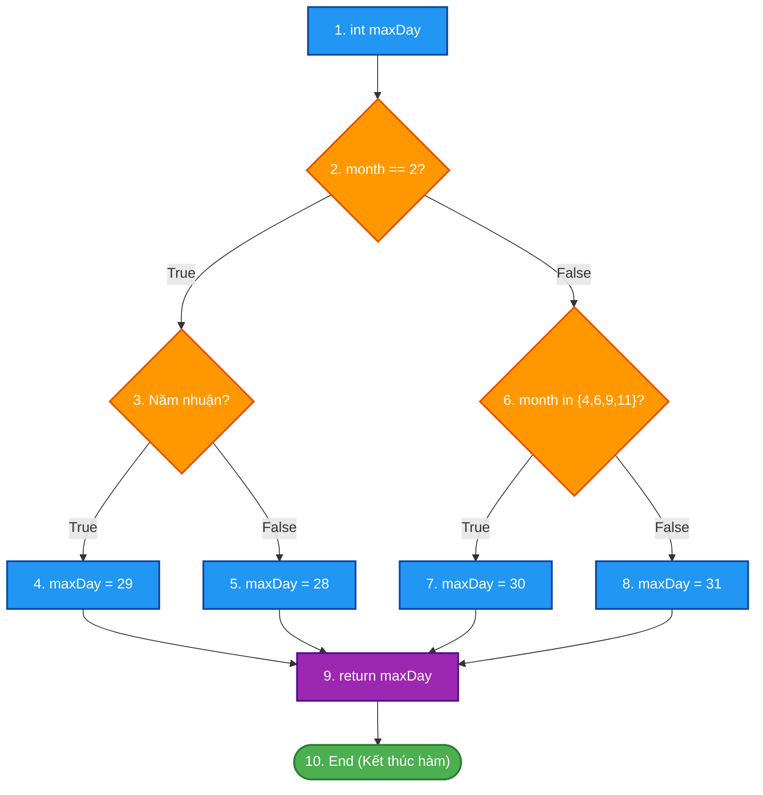
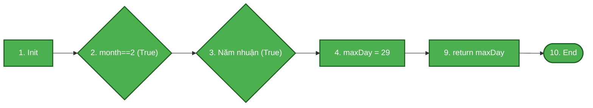
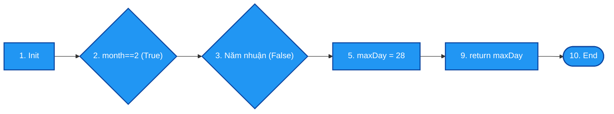
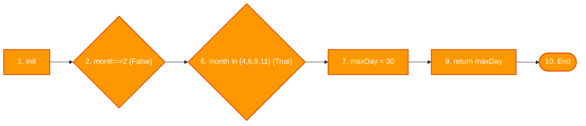
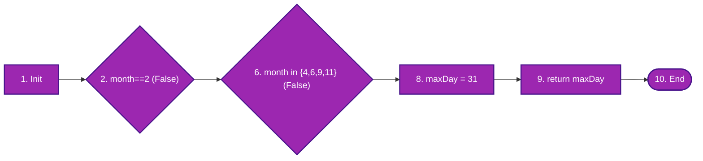

# ĐỀ THI GIỮA KỲ – MÔN KIỂM THỬ PHẦN MỀM
## **ĐỀ 03 – KỊCH BẢN 1**
### Thời gian: 60 phút | Được sử dụng tài liệu: Không

---

## CÂU 1 (6 ĐIỂM) – KIỂM THỬ HỘP ĐEN (Black-box Testing)

### Đặc tả bài toán: Hệ thống đăng ký tài khoản diễn đàn trực tuyến

Một diễn đàn trực tuyến cho phép người dùng đăng ký tài khoản với các quy định sau:

- **Độ tuổi đăng ký hợp lệ:** Tối thiểu **13 tuổi**, tối đa **99 tuổi**. Người ngoài độ tuổi này không được đăng ký.
- **Tên đăng nhập (Username):** Độ dài từ **6 đến 20 ký tự**, chỉ gồm chữ cái, chữ số và dấu gạch dưới `_`. Không được bắt đầu bằng chữ số.
- **Phân loại thành viên** theo độ tuổi hợp lệ:

| Độ tuổi | Loại thành viên | Quyền hạn |
|:--|:--|:--|
| 13 – 17 tuổi | Thành viên Thiếu niên | Đọc bài, bình luận, không được tạo chủ đề |
| 18 – 60 tuổi | Thành viên Trưởng thành | Toàn quyền (đọc, bình luận, tạo chủ đề) |
| 61 – 99 tuổi | Thành viên Cao tuổi | Đọc bài, bình luận, không được tạo chủ đề |

---

### a. Áp dụng kỹ thuật Kiểm thử Lớp tương đương (3 điểm)

**Yêu cầu:**
1. Xác định các biến đầu vào và phân chia lớp tương đương hợp lệ / không hợp lệ cho từng biến.
2. Thiết kế bảng ca kiểm thử (Test Cases) tương ứng, đảm bảo mỗi lớp được bao phủ ít nhất một lần.

---

### b. Áp dụng kỹ thuật Kiểm thử Giá trị biên (3 điểm)

**Yêu cầu:**
1. Xác định các điểm biên cho biến **Độ tuổi** và biến **Độ dài tên đăng nhập**.
2. Thiết kế bảng ca kiểm thử (BVA Test Cases) cho tất cả các giá trị biên đã xác định.

---

## CÂU 2 (4 ĐIỂM) – KIỂM THỬ HỘP TRẮNG (White-box Testing)

### Mã nguồn:

```c
int GetMaxDay(int month, int year)
{
    int maxDay;
    if (month == 2)
    {
        if ((year % 4 == 0 && year % 100 != 0) || (year % 400 == 0))
            maxDay = 29;
        else
            maxDay = 28;
    }
    else if (month == 4 || month == 6 || month == 9 || month == 11)
        maxDay = 30;
    else
        maxDay = 31;
    return maxDay;
}
```

**Yêu cầu:**
1. Vẽ Đồ thị luồng điều khiển (CFG) của hàm trên. Đánh số nút rõ ràng.
2. Tính độ phức tạp Cyclomatic V(G) bằng hai công thức khác nhau.
3. Liệt kê các đường thi hành độc lập (Basis Paths).
4. Thiết kế bảng ca kiểm thử tương ứng cho từng đường thi hành (ghi rõ Input, đường đi qua các nút, kết quả mong đợi).

---

### Hết

---
---

# LỜI GIẢI CHI TIẾT – ĐỀ 03 KỊCH BẢN 1

---

## CÂU 1 – LỜI GIẢI (6 điểm)

### Xác định biến đầu vào

| Biến | Ký hiệu | Miền giá trị hợp lệ |
|:--|:--|:--|
| Độ tuổi | A | 13 ≤ A ≤ 99 (số nguyên) |
| Tên đăng nhập | U | Chuỗi 6–20 ký tự, gồm [a-z, A-Z, 0-9, _], không bắt đầu bằng số |

---

### a. Kiểm thử Lớp tương đương (3 điểm)

#### Bước 1: Phân chia lớp tương đương

| Biến | Lớp hợp lệ | Lớp không hợp lệ |
|:--|:--|:--|
| Độ tuổi (A) | **EC1:** 13 ≤ A ≤ 17 → Thiếu niên | **EC7:** A < 13 |
| | **EC2:** 18 ≤ A ≤ 60 → Trưởng thành | **EC8:** A > 99 |
| | **EC3:** 61 ≤ A ≤ 99 → Cao tuổi | **EC9:** A không phải số nguyên |
| Username (U) | **EC4:** Dài 6–20 ký tự, ký tự hợp lệ, không bắt đầu bằng số | **EC10:** Dài < 6 ký tự |
| | | **EC11:** Dài > 20 ký tự |
| | | **EC12:** Chứa ký tự đặc biệt (không phải _, a-z, 0-9) |
| | | **EC13:** Bắt đầu bằng chữ số |

#### Bước 2: Bảng ca kiểm thử Lớp tương đương

| TC ID | Mục đích | Tuổi (A) | Username (U) | Lớp bao phủ | Kết quả mong đợi |
|:--:|:--|:--:|:--:|:--:|:--|
| **TC01** | Đăng ký thành viên Thiếu niên | 15 | user_abc | EC1, EC4 | Thành công. Loại: Thiếu niên |
| **TC02** | Đăng ký thành viên Trưởng thành | 25 | user_abc | EC2, EC4 | Thành công. Loại: Trưởng thành |
| **TC03** | Đăng ký thành viên Cao tuổi | 70 | user_abc | EC3, EC4 | Thành công. Loại: Cao tuổi |
| **TC04** | Tuổi dưới 13 | 10 | user_abc | EC7, EC4 | Lỗi: Độ tuổi tối thiểu là 13 |
| **TC05** | Tuổi trên 99 | 105 | user_abc | EC8, EC4 | Lỗi: Độ tuổi tối đa là 99 |
| **TC06** | Tuổi không phải số | "abc" | user_abc | EC9, EC4 | Lỗi: Tuổi phải là số nguyên |
| **TC07** | Username quá ngắn (< 6 ký tự) | 25 | abc | EC2, EC10 | Lỗi: Username tối thiểu 6 ký tự |
| **TC08** | Username quá dài (> 20 ký tự) | 25 | abcdefghijklmnopqrstu | EC2, EC11 | Lỗi: Username tối đa 20 ký tự |
| **TC09** | Username chứa ký tự đặc biệt | 25 | user@name | EC2, EC12 | Lỗi: Ký tự không hợp lệ trong username |
| **TC10** | Username bắt đầu bằng số | 25 | 1username | EC2, EC13 | Lỗi: Username không được bắt đầu bằng số |

---

### b. Kiểm thử Giá trị biên (3 điểm)

#### Bước 1: Xác định điểm biên

- **Biến Độ tuổi (A):** Miền [13, 99], điểm phân chia tại 17/18 và 60/61.
  - Biên tại 13: {12, 13, 14}
  - Biên phân chia 17/18: {16, 17, 18}
  - Biên phân chia 60/61: {59, 60, 61}
  - Biên tại 99: {98, 99, 100}

- **Biến Độ dài Username (L):** Miền [6, 20].
  - Biên tại 6: {5, 6, 7}
  - Biên tại 20: {19, 20, 21}

#### Bước 2: Bảng ca kiểm thử Giá trị biên

**Biên Độ tuổi** (dùng username hợp lệ cố định: `user_ok`):

| TC ID | Mô tả | Tuổi (A) | Kết quả mong đợi |
|:--:|:--|:--:|:--|
| **BVA01** | Dưới biên tối thiểu tuổi | 12 | Lỗi: Không đủ tuổi đăng ký |
| **BVA02** | Biên tối thiểu tuổi | 13 | Thành công. Loại: Thiếu niên |
| **BVA03** | Ngay trên biên tối thiểu | 14 | Thành công. Loại: Thiếu niên |
| **BVA04** | Ngay dưới biên phân chia 17/18 | 16 | Thành công. Loại: Thiếu niên |
| **BVA05** | Biên trên Thiếu niên | 17 | Thành công. Loại: Thiếu niên |
| **BVA06** | Biên dưới Trưởng thành | 18 | Thành công. Loại: Trưởng thành |
| **BVA07** | Ngay dưới biên phân chia 60/61 | 59 | Thành công. Loại: Trưởng thành |
| **BVA08** | Biên trên Trưởng thành | 60 | Thành công. Loại: Trưởng thành |
| **BVA09** | Biên dưới Cao tuổi | 61 | Thành công. Loại: Cao tuổi |
| **BVA10** | Ngay dưới biên tối đa tuổi | 98 | Thành công. Loại: Cao tuổi |
| **BVA11** | Biên tối đa tuổi | 99 | Thành công. Loại: Cao tuổi |
| **BVA12** | Vượt biên tối đa tuổi | 100 | Lỗi: Độ tuổi vượt quá giới hạn |

**Biên Độ dài Username** (dùng tuổi hợp lệ cố định: 25):

| TC ID | Mô tả | Độ dài Username | Kết quả mong đợi |
|:--:|:--|:--:|:--|
| **BVA13** | Dưới biên tối thiểu username | 5 (vd: `user1`) | Lỗi: Username tối thiểu 6 ký tự |
| **BVA14** | Biên tối thiểu username | 6 (vd: `user12`) | Thành công |
| **BVA15** | Ngay trên biên tối thiểu | 7 (vd: `user123`) | Thành công |
| **BVA16** | Ngay dưới biên tối đa username | 19 | Thành công |
| **BVA17** | Biên tối đa username | 20 | Thành công |
| **BVA18** | Vượt biên tối đa username | 21 | Lỗi: Username tối đa 20 ký tự |

---

## CÂU 2 – LỜI GIẢI (4 điểm)

### Bước 1: Đánh số câu lệnh và xác định các nút trong Đồ thị luồng điều khiển (CFG)

Mã nguồn hàm `GetMaxDay(int month, int year)` được phân tách thành các nút đồ thị:
- **Nút 1:** `int maxDay;` (Vào hàm, khai báo biến kết quả)
- **Nút 2:** `if (month == 2)` (Vị từ rẽ nhánh 1: kiểm tra có phải tháng 2)
- **Nút 3:** `if ((year % 4 == 0 && year % 100 != 0) || (year % 400 == 0))` (Vị từ rẽ nhánh 2: kiểm tra năm nhuận)
- **Nút 4:** `maxDay = 29;` (Gán số ngày tháng 2 năm nhuận)
- **Nút 5:** `maxDay = 28;` (Gán số ngày tháng 2 năm thường)
- **Nút 6:** `else if (month == 4 || month == 6 || month == 9 || month == 11)` (Vị từ rẽ nhánh 3: kiểm tra nhóm tháng có 30 ngày)
- **Nút 7:** `maxDay = 30;` (Gán 30 ngày)
- **Nút 8:** `maxDay = 31;` (Gán 31 ngày cho các tháng còn lại)
- **Nút 9:** `return maxDay;` (Trả về số ngày lớn nhất)
- **Nút 10:** `End / Exit` (Điểm kết thúc hàm)

---

### Sơ đồ Đồ thị luồng điều khiển (CFG) tổng quát



---

### Bước 2: Tính độ phức tạp Cyclomatic $V(G)$

Thống kê các thành phần của đồ thị luồng điều khiển $G$:
- **Số nút ($N$):** $10$ (từ Nút 1 đến Nút 10)
- **Số cung ($E$):** $12$
  - Các cung: $(1\to2)$, $(2\to3)$, $(2\to6)$, $(3\to4)$, $(3\to5)$, $(4\to9)$, $(5\to9)$, $(6\to7)$, $(6\to8)$, $(7\to9)$, $(8\to9)$, $(9\to10)$
- **Số nút vị từ phân nhánh ($P$):** $3$ nút điều kiện (Nút 2, Nút 3, Nút 6)

Áp dụng 2 công thức chuẩn theo giáo trình:
- **Công thức 1 (Theo số cung và số nút):**
  $$V(G) = E - N + 2 = 12 - 10 + 2 = 4$$
- **Công thức 2 (Theo số nút vị từ $P$):**
  $$V(G) = P + 1 = 3 + 1 = 4$$

*(Kiểm chứng theo số miền phẳng $R$: Đồ thị có 3 miền đóng và 1 miền mở bao quanh $\implies V(G) = R = 4$)*.

> **Kết luận:** Độ phức tạp Cyclomatic $V(G) = 4$. Cần tối thiểu **4 đường thi hành cơ sở (Basis Paths)** độc lập tuyến tính để bao phủ kiểm thử.

---

### Bước 3: Sơ đồ hóa từng đường thi hành cơ sở (Basis Paths)

#### 🔹 Đường 1 (P1): Tháng 2 và là năm nhuận
- **Đường đi:** $1 \to 2(\text{True}) \to 3(\text{True}) \to 4 \to 9 \to 10$
- **Đặc điểm:** Bao phủ nhánh `True` của Nút 2 và nhánh `True` của Nút 3; gán `maxDay = 29`.



#### 🔹 Đường 2 (P2): Tháng 2 và là năm thường (không nhuận)
- **Đường đi:** $1 \to 2(\text{True}) \to 3(\text{False}) \to 5 \to 9 \to 10$
- **Đặc điểm:** Bao phủ nhánh `True` của Nút 2 và nhánh `False` của Nút 3; gán `maxDay = 28`.



#### 🔹 Đường 3 (P3): Không phải tháng 2, thuộc nhóm tháng 4, 6, 9, 11
- **Đường đi:** $1 \to 2(\text{False}) \to 6(\text{True}) \to 7 \to 9 \to 10$
- **Đặc điểm:** Bao phủ nhánh `False` của Nút 2 và nhánh `True` của Nút 6; gán `maxDay = 30`.



#### 🔹 Đường 4 (P4): Không phải tháng 2, thuộc các tháng còn lại (1, 3, 5, 7, 8, 10, 12)
- **Đường đi:** $1 \to 2(\text{False}) \to 6(\text{False}) \to 8 \to 9 \to 10$
- **Đặc điểm:** Bao phủ nhánh `False` của Nút 2 và nhánh `False` của Nút 6; gán `maxDay = 31`.



---

### Bước 4: Ma trận bao phủ các cung (Branch / Edge Coverage Matrix)

| Cung (Edge) | Nhãn nhánh | P1 | P2 | P3 | P4 | Mức độ bao phủ |
|:---:|:---|:---:|:---:|:---:|:---:|:---:|
| **e1** ($1 \to 2$) | Khai báo vào kiểm tra tháng | ✓ | ✓ | ✓ | ✓ | 100% |
| **e2** ($2 \to 3$) | Nhánh `month == 2` là True | ✓ | ✓ | | | 100% |
| **e3** ($2 \to 6$) | Nhánh `month == 2` là False | | | ✓ | ✓ | 100% |
| **e4** ($3 \to 4$) | Nhánh năm nhuận là True | ✓ | | | | 100% |
| **e5** ($3 \to 5$) | Nhánh năm nhuận là False | | ✓ | | | 100% |
| **e6** ($4 \to 9$) | Gán 29 ngày chuyển sang return | ✓ | | | | 100% |
| **e7** ($5 \to 9$) | Gán 28 ngày chuyển sang return | | ✓ | | | 100% |
| **e8** ($6 \to 7$) | Nhánh tháng 30 ngày là True | | | ✓ | | 100% |
| **e9** ($6 \to 8$) | Nhánh tháng 30 ngày là False | | | | ✓ | 100% |
| **e10** ($7 \to 9$) | Gán 30 ngày chuyển sang return | | | ✓ | | 100% |
| **e11** ($8 \to 9$) | Gán 31 ngày chuyển sang return | | | | ✓ | 100% |
| **e12** ($9 \to 10$) | Trả về kết quả đến kết thúc | ✓ | ✓ | ✓ | ✓ | 100% |

---

### Bước 5: Bảng ca kiểm thử hộp trắng (White-box Test Cases)

| TC ID | Mục tiêu kiểm thử | Dữ liệu đầu vào (`month`, `year`) | Luồng thực thi qua các nút | Kết quả mong đợi (`maxDay`) | Tiêu chí bao phủ đạt được |
|:---:|:---|:---|:---|:---:|:---|
| **TC_P1** | Phủ đường P1 (Tháng 2, năm nhuận) | `month = 2`, `year = 2024`<br>*(2024 chia hết cho 4, không chia hết cho 100)* | $1 \to 2(T) \to 3(T) \to 4 \to 9 \to 10$ | `29` | Nhánh True Nút 2, Nhánh True Nút 3, câu lệnh Nút 4 |
| **TC_P2** | Phủ đường P2 (Tháng 2, năm thường) | `month = 2`, `year = 2023`<br>*(2023 không chia hết cho 4)* | $1 \to 2(T) \to 3(F) \to 5 \to 9 \to 10$ | `28` | Nhánh True Nút 2, Nhánh False Nút 3, câu lệnh Nút 5 |
| **TC_P3** | Phủ đường P3 (Tháng 30 ngày) | `month = 4`, `year = 2024` | $1 \to 2(F) \to 6(T) \to 7 \to 9 \to 10$ | `30` | Nhánh False Nút 2, Nhánh True Nút 6, câu lệnh Nút 7 |
| **TC_P4** | Phủ đường P4 (Tháng 31 ngày) | `month = 1`, `year = 2024` | $1 \to 2(F) \to 6(F) \to 8 \to 9 \to 10$ | `31` | Nhánh False Nút 2, Nhánh False Nút 6, câu lệnh Nút 8 |

---

> **Tổng kết thang điểm đạt được:**
> - **Vẽ sơ đồ CFG:** 1.0 điểm – Đầy đủ nút, nhánh rẽ điều kiện và điểm hội tụ rõ ràng.
> - **Tính Cyclomatic Complexity $V(G)$:** 1.0 điểm – Trình bày đủ 2 công thức $E - N + 2 = 12 - 10 + 2 = 4$ và $P + 1 = 3 + 1 = 4$.
> - **Liệt kê và sơ đồ hóa các Basis Paths:** 1.0 điểm – 4 đường cơ sở có sơ đồ minh họa luồng thực thi trực quan.
> - **Thiết kế bảng Ca kiểm thử (Test Cases):** 1.0 điểm – Input cụ thể, vết luồng đi qua các nút và kết quả trả về chính xác.
