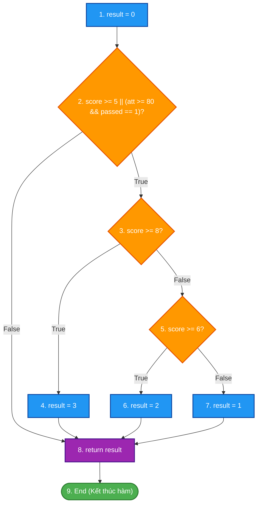
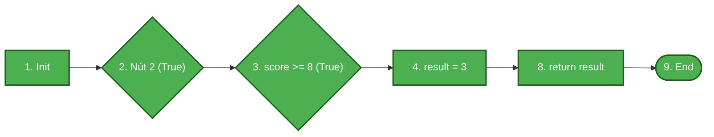
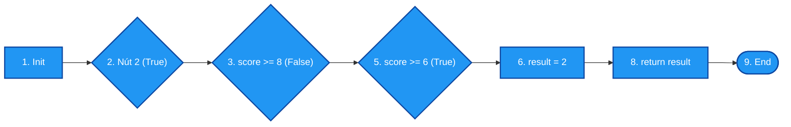
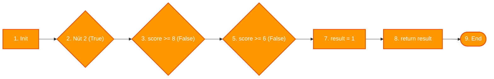
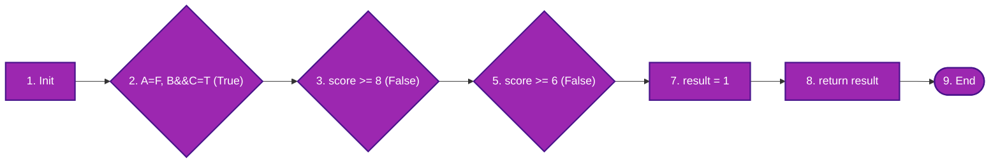
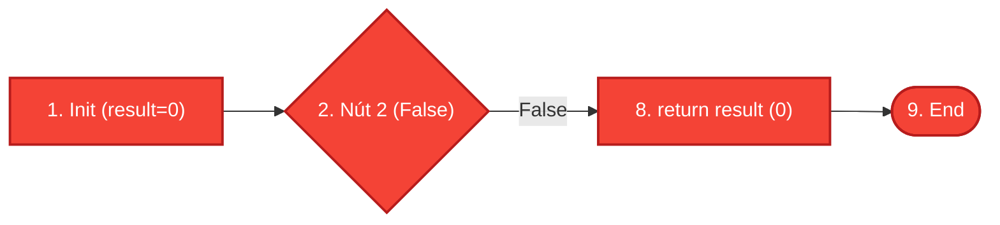

# ĐỀ THI GIỮA KỲ – MÔN KIỂM THỬ PHẦN MỀM
## **ĐỀ 01 – KỊCH BẢN 2**
### Thời gian: 60 phút | Được sử dụng tài liệu: Không

---

## CÂU 1 (6 ĐIỂM) – KIỂM THỬ HỘP ĐEN (Black-box Testing)

### Đặc tả bài toán: Hệ thống xét học bổng sinh viên

Một trường đại học xét học bổng cho sinh viên dựa trên **ba điều kiện** sau:

- **C1 – Điểm trung bình tích lũy (GPA):** Đạt từ **3.2 trở lên** (thang 4.0) là điều kiện học lực tốt.
- **C2 – Số tín chỉ đã hoàn thành:** Đã tích lũy từ **60 tín chỉ trở lên**.
- **C3 – Tình trạng kỷ luật:** Không có cảnh cáo kỷ luật trong học kỳ hiện tại.

**Các mức học bổng:**

| Điều kiện thỏa mãn | Mức học bổng |
|:--|:--|
| Cả 3 điều kiện đều đạt | Học bổng Xuất sắc – 100% học phí |
| Chỉ C1 và C3 đạt (thiếu C2) | Học bổng Khuyến khích – 50% học phí |
| Chỉ C1 đạt (thiếu C2 hoặc C3) | Học bổng Tiềm năng – 20% học phí |
| Không đạt C1 | Không được học bổng |

---

### Áp dụng kỹ thuật Kiểm thử Bảng quyết định (Decision Table Testing) (6 điểm)

**Yêu cầu:**
1. Xác định các điều kiện (Conditions) và hành động (Actions) của bài toán.
2. Xây dựng **Bảng quyết định (Decision Table)** đầy đủ với tất cả các tổ hợp điều kiện có thể.
3. Thiết kế **ca kiểm thử (Test Cases)** tương ứng cho mỗi quy tắc (rule) trong bảng quyết định. Ghi rõ: Mã TC, dữ liệu đầu vào, kết quả mong đợi.

---

## CÂU 2 (4 ĐIỂM) – KIỂM THỬ HỘP TRẮNG (White-box Testing)

### Mã nguồn:

```c
int classify(int score, int attendance, int passed)
{
    int result = 0;
    if (score >= 5 || (attendance >= 80 && passed == 1))
    {
        if (score >= 8)
            result = 3;
        else if (score >= 6)
            result = 2;
        else
            result = 1;
    }
    return result;
}
```

> **Chú thích:** `score`: Điểm số (0–10), `attendance`: % chuyên cần (0–100), `passed`: Đã nộp đủ bài tập (1: có, 0: không).
> Trả về: 3 = Giỏi, 2 = Khá, 1 = Trung bình, 0 = Không đạt.

**Yêu cầu:**
1. Vẽ Đồ thị luồng điều khiển (CFG) của hàm trên. Đánh số nút rõ ràng.
2. Tính độ phức tạp Cyclomatic V(G) bằng hai công thức khác nhau.
3. Liệt kê tất cả các đường thi hành (paths) thỏa mãn tiêu chí **Bao phủ nhánh và điều kiện (Branch & Condition Coverage)**.
4. Thiết kế bảng ca kiểm thử tương ứng (ghi rõ Input, nhánh/điều kiện được bao phủ, kết quả mong đợi).

---

### Hết

---
---

# LỜI GIẢI CHI TIẾT – ĐỀ 01 KỊCH BẢN 2

---

## CÂU 1 – LỜI GIẢI (6 điểm)

### Bước 1: Xác định Điều kiện và Hành động

**Các điều kiện (Conditions):**

| Ký hiệu | Điều kiện |
|:--:|:--|
| **C1** | GPA ≥ 3.2 (T/F) |
| **C2** | Tín chỉ ≥ 60 (T/F) |
| **C3** | Không có cảnh cáo kỷ luật (T/F) |

**Các hành động (Actions):**

| Ký hiệu | Hành động |
|:--:|:--|
| **A1** | Học bổng Xuất sắc – 100% học phí |
| **A2** | Học bổng Khuyến khích – 50% học phí |
| **A3** | Học bổng Tiềm năng – 20% học phí |
| **A4** | Không được học bổng |

---

### Bước 2: Bảng quyết định (Decision Table)

3 điều kiện nhị phân → tối đa 2³ = 8 tổ hợp. Phân tích theo đặc tả:

| Điều kiện / Hành động | R1 | R2 | R3 | R4 | R5 | R6 | R7 | R8 |
|:--|:--:|:--:|:--:|:--:|:--:|:--:|:--:|:--:|
| **C1: GPA ≥ 3.2** | T | T | T | T | F | F | F | F |
| **C2: TC ≥ 60** | T | T | F | F | T | T | F | F |
| **C3: Không KL** | T | F | T | F | T | F | T | F |
| **A1: XS – 100%** | **X** | | | | | | | |
| **A2: KK – 50%** | | | **X** | | | | | |
| **A3: TN – 20%** | | **X** | | **X** | | | | |
| **A4: Không HB** | | | | | **X** | **X** | **X** | **X** |

> **Giải thích:**
> - R1 (T,T,T): Cả 3 đạt → A1 (Xuất sắc)
> - R2 (T,T,F): C1+C2 đạt, có KL → chỉ C1 đạt (vì KL ảnh hưởng) → A3 (Tiềm năng)
> - R3 (T,F,T): C1+C3 đạt, thiếu C2 → A2 (Khuyến khích)
> - R4 (T,F,F): Chỉ C1 đạt → A3 (Tiềm năng)
> - R5–R8: Không đạt C1 → A4 (Không học bổng)

---

### Bước 3: Bảng ca kiểm thử

| TC ID | GPA | Tín chỉ | Kỷ luật | Rule | Kết quả mong đợi |
|:--:|:--:|:--:|:--:|:--:|:--|
| **TC01** | 3.5 | 65 | Không có | R1 | Học bổng Xuất sắc – 100% học phí |
| **TC02** | 3.6 | 70 | Có cảnh cáo | R2 | Học bổng Tiềm năng – 20% học phí |
| **TC03** | 3.4 | 45 | Không có | R3 | Học bổng Khuyến khích – 50% học phí |
| **TC04** | 3.3 | 50 | Có cảnh cáo | R4 | Học bổng Tiềm năng – 20% học phí |
| **TC05** | 2.8 | 80 | Không có | R5 | Không được học bổng |
| **TC06** | 2.5 | 75 | Có cảnh cáo | R6 | Không được học bổng |
| **TC07** | 3.0 | 40 | Không có | R7 | Không được học bổng |
| **TC08** | 2.9 | 30 | Có cảnh cáo | R8 | Không được học bổng |

---

## CÂU 2 – LỜI GIẢI (4 điểm)

### Bước 1: Đánh số câu lệnh và xác định các nút trong Đồ thị luồng điều khiển (CFG)

Mã nguồn hàm `classify(int score, int attendance, int passed)` được phân tách thành các nút đồ thị:
- **Nút 1:** `int result = 0;` (Khởi tạo kết quả mặc định)
- **Nút 2:** `if (score >= 5 || (attendance >= 80 && passed == 1))` (Vị từ phức hợp điều kiện qua môn)
- **Nút 3:** `if (score >= 8)` (Vị từ phân loại Giỏi)
- **Nút 4:** `result = 3;` (Gán xếp loại Giỏi)
- **Nút 5:** `else if (score >= 6)` (Vị từ phân loại Khá)
- **Nút 6:** `result = 2;` (Gán xếp loại Khá)
- **Nút 7:** `result = 1;` (Gán xếp loại Trung bình)
- **Nút 8:** `return result;` (Trả về kết quả xếp loại)
- **Nút 9:** `End / Exit` (Điểm kết thúc hàm)

---

### Sơ đồ Đồ thị luồng điều khiển (CFG) tổng quát



---

### Bước 2: Tính độ phức tạp Cyclomatic $V(G)$

Thống kê các thành phần của đồ thị luồng điều khiển $G$:
- **Số nút ($N$):** $9$ (từ Nút 1 đến Nút 9)
- **Số cung ($E$):** $11$
  - Các cung: $(1\to2)$, $(2\to3)$, $(2\to8)$, $(3\to4)$, $(3\to5)$, $(4\to8)$, $(5\to6)$, $(5\to7)$, $(6\to8)$, $(7\to8)$, $(8\to9)$
- **Số nút vị từ phân nhánh ($P$):** $3$ nút điều kiện (Nút 2, Nút 3, Nút 5)

Áp dụng 2 công thức chuẩn theo giáo trình:
- **Công thức 1 (Theo số cung và số nút):**
  $$V(G) = E - N + 2 = 11 - 9 + 2 = 4$$
- **Công thức 2 (Theo số nút vị từ $P$):**
  $$V(G) = P + 1 = 3 + 1 = 4$$

*(Kiểm chứng theo số miền phẳng $R$: Đồ thị có 3 miền khép kín và 1 miền mở vô hạn bao quanh $\implies V(G) = R = 4$)*.

> **Kết luận:** Độ phức tạp Cyclomatic $V(G) = 4$.

---

### Bước 3: Sơ đồ hóa các đường thi hành theo tiêu chí Branch & Condition Coverage

Để đạt **Bao phủ nhánh và điều kiện (Branch & Condition Coverage)**:
1. Mọi nhánh rẽ của tất cả các nút quyết định đều phải được thực thi ít nhất một lần (Branch Coverage).
2. Từng điều kiện thành phần trong biểu thức phức hợp tại Nút 2: $A = (\text{score} \ge 5)$, $B = (\text{attendance} \ge 80)$, $C = (\text{passed} == 1)$ đều phải nhận cả giá trị `True` và `False` ít nhất một lần (Condition Coverage).

#### 🔹 Đường P1 (Xếp loại Giỏi - Branch Nút 3 True)
- **Luồng:** $1 \to 2(\text{True}) \to 3(\text{True}) \to 4 \to 8 \to 9$
- **Trạng thái điều kiện:** $A = \text{True}, B = \text{True}, C = \text{True} \implies$ Nút 2 True, Nút 3 True $\implies result = 3$.



#### 🔹 Đường P2 (Xếp loại Khá - Branch Nút 5 True)
- **Luồng:** $1 \to 2(\text{True}) \to 3(\text{False}) \to 5(\text{True}) \to 6 \to 8 \to 9$
- **Trạng thái điều kiện:** $A = \text{True}, B = \text{False}, C = \text{True} \implies$ Nút 2 True, Nút 3 False, Nút 5 True $\implies result = 2$.



#### 🔹 Đường P3 (Xếp loại Trung bình - Branch Nút 5 False)
- **Luồng:** $1 \to 2(\text{True}) \to 3(\text{False}) \to 5(\text{False}) \to 7 \to 8 \to 9$
- **Trạng thái điều kiện:** $A = \text{True}, B = \text{False}, C = \text{False} \implies$ Nút 2 True, Nút 3 False, Nút 5 False $\implies result = 1$.



#### 🔹 Đường P4 (Vào Nút 2 nhờ điều kiện phụ $B \land C$ khi $A = \text{False}$)
- **Luồng:** $1 \to 2(\text{True}) \to 3(\text{False}) \to 5(\text{False}) \to 7 \to 8 \to 9$
- **Trạng thái điều kiện:** $A = \text{False}, B = \text{True}, C = \text{True} \implies$ Nhánh $B \land C$ kích hoạt Nút 2 True $\implies result = 1$.



#### 🔹 Đường P5 (Không đạt - Branch Nút 2 False)
- **Luồng:** $1 \to 2(\text{False}) \to 8 \to 9$
- **Trạng thái điều kiện:** $A = \text{False}, B = \text{False}, C = \text{False} \implies$ Nút 2 False $\implies result = 0$.



---

### Bước 4: Ma trận kiểm chứng Bao phủ điều kiện con (Condition Coverage Matrix)

| Ca kiểm thử | $A$: `score >= 5` | $B$: `att >= 80` | $C$: `passed == 1` | Biểu thức Nút 2 | Nhánh Nút 3 | Nhánh Nút 5 | Kết quả (`result`) |
|:---:|:---:|:---:|:---:|:---:|:---:|:---:|:---:|
| **TC01** | **True** | **True** | **True** | True | **True** | *(bỏ qua)* | 3 (Giỏi) |
| **TC02** | True | **False** | True | True | **False** | **True** | 2 (Khá) |
| **TC03** | True | False | **False** | True | False | **False** | 1 (Trung bình) |
| **TC04** | **False** | True | True | True | False | False | 1 (Trung bình) |
| **TC05** | False | False | False | **False** | *(bỏ qua)* | *(bỏ qua)* | 0 (Không đạt) |

> **Kiểm chứng mức độ bao phủ:**
> - Điều kiện con $A$: có `True` (TC01, TC02, TC03) và `False` (TC04, TC05) $\implies$ **100% Condition A**.
> - Điều kiện con $B$: có `True` (TC01, TC04) và `False` (TC02, TC03, TC05) $\implies$ **100% Condition B**.
> - Điều kiện con $C$: có `True` (TC01, TC02, TC04) và `False` (TC03, TC05) $\implies$ **100% Condition C**.
> - Quyết định Nút 2: có `True` (TC01–TC04) và `False` (TC05) $\implies$ **100% Branch Nút 2**.
> - Quyết định Nút 3: có `True` (TC01) và `False` (TC02–TC04) $\implies$ **100% Branch Nút 3**.
> - Quyết định Nút 5: có `True` (TC02) và `False` (TC03, TC04) $\implies$ **100% Branch Nút 5**.

---

### Bước 5: Bảng ca kiểm thử hộp trắng hoàn chỉnh (White-box Test Cases)

| TC ID | Mục tiêu kiểm thử | `score` | `attendance` | `passed` | Vết thực thi qua các nút | Kết quả mong đợi | Tiêu chí bao phủ đạt được |
|:---:|:---|:---:|:---:|:---:|:---|:---:|:---|
| **TC01** | Phủ Giỏi (Nút 3 True), A=T, B=T, C=T | 9 | 90 | 1 | $1 \to 2(T) \to 3(T) \to 4 \to 8 \to 9$ | `3` | Nhánh True Nút 3, câu lệnh Nút 4 |
| **TC02** | Phủ Khá (Nút 5 True), B=F | 7 | 70 | 1 | $1 \to 2(T) \to 3(F) \to 5(T) \to 6 \to 8 \to 9$ | `2` | Nhánh True Nút 5, câu lệnh Nút 6 |
| **TC03** | Phủ TB (Nút 5 False), C=F | 5 | 60 | 0 | $1 \to 2(T) \to 3(F) \to 5(F) \to 7 \to 8 \to 9$ | `1` | Nhánh False Nút 5, câu lệnh Nút 7 |
| **TC04** | Phủ nhánh phụ $(B \land C)$, A=F | 3 | 85 | 1 | $1 \to 2(T) \to 3(F) \to 5(F) \to 7 \to 8 \to 9$ | `1` | Kiểm chứng điều kiện $A=\text{False}$ nhưng Nút 2 vẫn True |
| **TC05** | Phủ Không đạt (Nút 2 False), toàn bộ F | 3 | 70 | 0 | $1 \to 2(F) \to 8 \to 9$ | `0` | Nhánh False Nút 2 |

---

> **Tổng kết thang điểm đạt được:**
> - **Vẽ sơ đồ CFG:** 1.0 điểm – Đầy đủ nút, nhánh rẽ điều kiện và điểm hội tụ rõ ràng.
> - **Tính Cyclomatic Complexity $V(G)$:** 1.0 điểm – Trình bày đủ 2 công thức $E - N + 2 = 11 - 9 + 2 = 4$ và $P + 1 = 3 + 1 = 4$.
> - **Phân tích và sơ đồ hóa Branch & Condition Coverage:** 1.0 điểm – Sơ đồ hóa từng đường, ma trận điều kiện con đầy đủ True/False.
> - **Thiết kế bảng Ca kiểm thử (Test Cases):** 1.0 điểm – Input chi tiết, vết thực thi và kết quả trả về chính xác.
