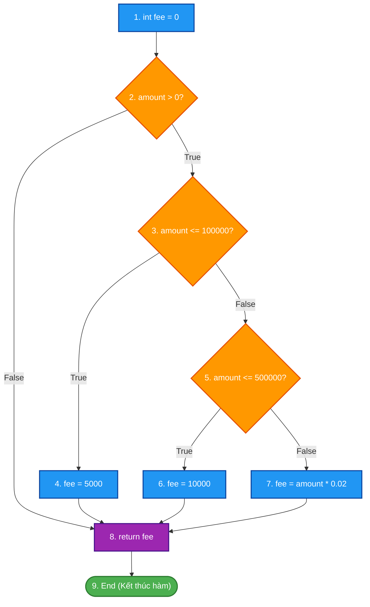
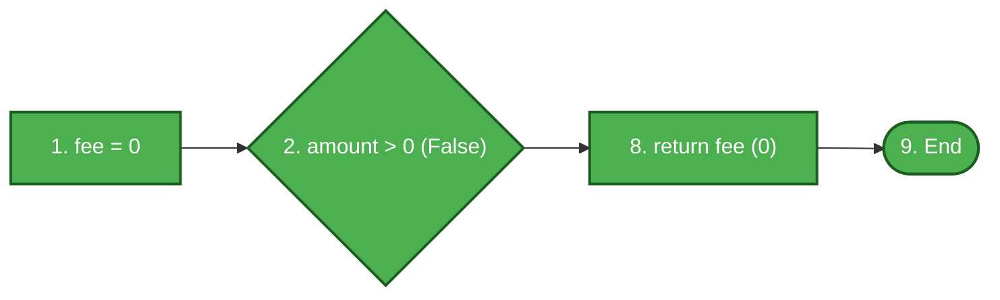
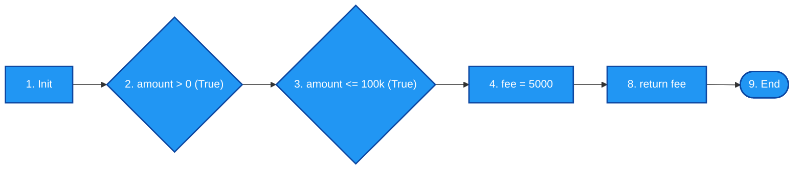
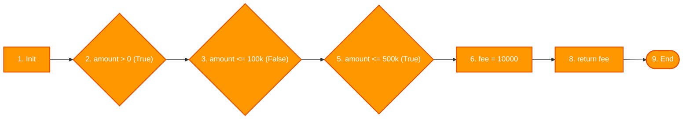
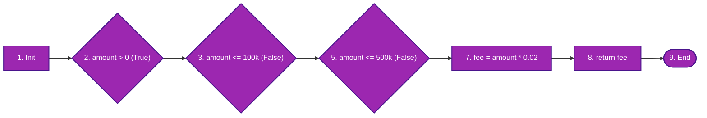

# ĐỀ THI GIỮA KỲ – MÔN KIỂM THỬ PHẦN MỀM
## **ĐỀ 02 – KỊCH BẢN 2**
### Thời gian: 60 phút | Được sử dụng tài liệu: Không

---

## CÂU 1 (6 ĐIỂM) – KIỂM THỬ HỘP ĐEN (Black-box Testing)

### Đặc tả bài toán: Hệ thống tính tiền vé và phát mũ tham quan bảo tàng

Bảo tàng quốc gia áp dụng chính sách bán vé và tặng quà lưu niệm như sau:

**Chính sách vé:**

| Độ tuổi khách tham quan | Giá vé |
|:--|:--|
| Dưới 5 tuổi | Miễn phí (0 VNĐ) |
| Từ 5 đến 65 tuổi | 40.000 VNĐ/vé |
| Trên 65 tuổi | 20.000 VNĐ/vé |

**Chính sách tặng mũ lưu niệm:**

| Giới tính | Màu mũ tặng |
|:--|:--|
| Khách Nữ | Mũ màu Hồng |
| Khách Nam | Mũ màu Xanh |

---

### Áp dụng kỹ thuật Kiểm thử Bảng quyết định (Decision Table Testing) (6 điểm)

**Yêu cầu:**
1. Xác định các điều kiện (Conditions) và hành động (Actions) của bài toán.
2. Xây dựng **Bảng quyết định (Decision Table)** đầy đủ với tất cả các tổ hợp điều kiện.
3. Thiết kế **ca kiểm thử (Test Cases)** tương ứng cho mỗi quy tắc trong bảng quyết định. Ghi rõ: Mã TC, dữ liệu đầu vào (tuổi, giới tính), kết quả mong đợi (giá vé, màu mũ).

---

## CÂU 2 (4 ĐIỂM) – KIỂM THỬ HỘP TRẮNG (White-box Testing)

### Mã nguồn:

```c
int calculate_fee(int amount)
{
    int fee = 0;
    if (amount > 0)
    {
        if (amount <= 100000)
            fee = 5000;
        else if (amount <= 500000)
            fee = 10000;
        else
            fee = amount * 0.02;
    }
    return fee;
}
```

> **Chú thích:** `amount`: Số tiền giao dịch (VNĐ). Trả về `fee` – phí dịch vụ cần trả.

**Yêu cầu:**
1. Vẽ Đồ thị luồng điều khiển (CFG) của hàm trên. Đánh số nút rõ ràng.
2. Tính độ phức tạp Cyclomatic V(G) bằng hai công thức khác nhau.
3. Xác định tập các đường thi hành cơ sở (Basis Paths) và liệt kê đầy đủ V(G) đường độc lập.
4. Áp dụng tiêu chí **Kiểm thử đường cơ bản (Basis Path Testing – McCabe)**: Thiết kế bảng ca kiểm thử tương ứng cho từng đường (ghi rõ Input, đường đi, kết quả mong đợi).

---

### Hết

---
---

# LỜI GIẢI CHI TIẾT – ĐỀ 02 KỊCH BẢN 2

---

## CÂU 1 – LỜI GIẢI (6 điểm)

### Bước 1: Xác định Điều kiện và Hành động

**Các điều kiện (Conditions):**

| Ký hiệu | Điều kiện | Giá trị có thể |
|:--:|:--|:--|
| **C1** | Độ tuổi khách | < 5 tuổi / 5–65 tuổi / > 65 tuổi (3 giá trị) |
| **C2** | Giới tính | Nam / Nữ (2 giá trị) |

**Các hành động (Actions):**

| Ký hiệu | Hành động |
|:--:|:--|
| **A1** | Vé miễn phí (0 VNĐ) |
| **A2** | Vé 40.000 VNĐ |
| **A3** | Vé 20.000 VNĐ |
| **A4** | Tặng mũ Hồng |
| **A5** | Tặng mũ Xanh |

---

### Bước 2: Bảng quyết định (Decision Table)

C1 có 3 giá trị × C2 có 2 giá trị = **6 tổ hợp (Rules)**:

| Điều kiện / Hành động | R1 | R2 | R3 | R4 | R5 | R6 |
|:--|:--:|:--:|:--:|:--:|:--:|:--:|
| **C1: Độ tuổi** | < 5 | < 5 | 5–65 | 5–65 | > 65 | > 65 |
| **C2: Giới tính** | Nữ | Nam | Nữ | Nam | Nữ | Nam |
| **A1: Vé 0đ** | **X** | **X** | | | | |
| **A2: Vé 40.000đ** | | | **X** | **X** | | |
| **A3: Vé 20.000đ** | | | | | **X** | **X** |
| **A4: Mũ Hồng** | **X** | | **X** | | **X** | |
| **A5: Mũ Xanh** | | **X** | | **X** | | **X** |

---

### Bước 3: Bảng ca kiểm thử

| TC ID | Tuổi | Giới tính | Rule | Giá vé | Màu mũ |
|:--:|:--:|:--:|:--:|:--:|:--:|
| **TC01** | 3 | Nữ | R1 | 0 VNĐ (Miễn phí) | Mũ Hồng |
| **TC02** | 4 | Nam | R2 | 0 VNĐ (Miễn phí) | Mũ Xanh |
| **TC03** | 30 | Nữ | R3 | 40.000 VNĐ | Mũ Hồng |
| **TC04** | 25 | Nam | R4 | 40.000 VNĐ | Mũ Xanh |
| **TC05** | 70 | Nữ | R5 | 20.000 VNĐ | Mũ Hồng |
| **TC06** | 75 | Nam | R6 | 20.000 VNĐ | Mũ Xanh |

---

## CÂU 2 – LỜI GIẢI (4 điểm)

### Bước 1: Đánh số câu lệnh và xác định các nút trong Đồ thị luồng điều khiển (CFG)

Mã nguồn hàm `calculate_fee(int amount)` được phân tách thành các nút đồ thị:
- **Nút 1:** `int fee = 0;` (Khởi tạo phí ban đầu)
- **Nút 2:** `if (amount > 0)` (Vị từ rẽ nhánh 1: kiểm tra số tiền giao dịch hợp lệ)
- **Nút 3:** `if (amount <= 100000)` (Vị từ rẽ nhánh 2: mức tiền nhỏ ≤ 100.000đ)
- **Nút 4:** `fee = 5000;` (Gán phí cố định 5.000đ)
- **Nút 5:** `else if (amount <= 500000)` (Vị từ rẽ nhánh 3: mức tiền vừa ≤ 500.000đ)
- **Nút 6:** `fee = 10000;` (Gán phí cố định 10.000đ)
- **Nút 7:** `fee = amount * 0.02;` (Tính phí theo tỷ lệ 2%)
- **Nút 8:** `return fee;` (Trả về mức phí tính được)
- **Nút 9:** `End / Exit` (Điểm kết thúc hàm)

---

### Sơ đồ Đồ thị luồng điều khiển (CFG) tổng quát



---

### Bước 2: Tính độ phức tạp Cyclomatic $V(G)$

Thống kê các thành phần của đồ thị luồng điều khiển $G$:
- **Số nút ($N$):** $9$ (từ Nút 1 đến Nút 9)
- **Số cung ($E$):** $11$
  - Các cung: $(1\to2)$, $(2\to3)$, $(2\to8)$, $(3\to4)$, $(3\to5)$, $(4\to8)$, $(5\to6)$, $(5\to7)$, $(6\to8)$, $(7\to8)$, $(8\to9)$
- **Số nút vị từ phân nhánh ($P$):** $3$ nút điều kiện (Nút 2, Nút 3, Nút 5)

Áp dụng 2 công thức chuẩn theo giáo trình:
- **Công thức 1 (Theo số cung và số nút):**
  $$V(G) = E - N + 2 = 11 - 9 + 2 = 4$$
- **Công thức 2 (Theo số nút vị từ $P$):**
  $$V(G) = P + 1 = 3 + 1 = 4$$

*(Kiểm chứng theo số miền phẳng $R$: Đồ thị có 3 miền đóng và 1 miền mở vô hạn bao quanh $\implies V(G) = R = 4$)*.

> **Kết luận:** Độ phức tạp Cyclomatic $V(G) = 4$. Cần tối thiểu **4 đường thi hành cơ sở (Basis Paths)** độc lập tuyến tính để bao phủ kiểm thử.

---

### Bước 3: Sơ đồ hóa từng đường thi hành cơ sở (Basis Paths)

#### 🔹 Đường 1 (P1): Tiền giao dịch không hợp lệ ($\le 0$)
- **Đường đi:** $1 \to 2(\text{False}) \to 8 \to 9$
- **Đặc điểm:** Bao phủ nhánh `False` của Nút 2; không tính phí; trả về `fee = 0`.



#### 🔹 Đường 2 (P2): Số tiền nhỏ ($0 < amount \le 100.000$)
- **Đường đi:** $1 \to 2(\text{True}) \to 3(\text{True}) \to 4 \to 8 \to 9$
- **Đặc điểm:** Bao phủ nhánh `True` của Nút 2 và nhánh `True` của Nút 3; gán `fee = 5000`.



#### 🔹 Đường 3 (P3): Số tiền vừa ($100.000 < amount \le 500.000$)
- **Đường đi:** $1 \to 2(\text{True}) \to 3(\text{False}) \to 5(\text{True}) \to 6 \to 8 \to 9$
- **Đặc điểm:** Bao phủ nhánh `False` của Nút 3 và nhánh `True` của Nút 5; gán `fee = 10000`.



#### 🔹 Đường 4 (P4): Số tiền lớn ($amount > 500.000$)
- **Đường đi:** $1 \to 2(\text{True}) \to 3(\text{False}) \to 5(\text{False}) \to 7 \to 8 \to 9$
- **Đặc điểm:** Bao phủ nhánh `False` của cả Nút 3 và Nút 5; tính phí tỷ lệ `fee = amount * 0.02`.



---

### Bước 4: Ma trận bao phủ các cung (Branch / Edge Coverage Matrix)

| Cung (Edge) | Nhãn nhánh | P1 | P2 | P3 | P4 | Mức độ bao phủ |
|:---:|:---|:---:|:---:|:---:|:---:|:---:|
| **e1** ($1 \to 2$) | Khởi tạo vào kiểm tra amount | ✓ | ✓ | ✓ | ✓ | 100% |
| **e2** ($2 \to 3$) | Nhánh `amount > 0` là True | | ✓ | ✓ | ✓ | 100% |
| **e3** ($2 \to 8$) | Nhánh `amount > 0` là False | ✓ | | | | 100% |
| **e4** ($3 \to 4$) | Nhánh `amount <= 100k` là True | | ✓ | | | 100% |
| **e5** ($3 \to 5$) | Nhánh `amount <= 100k` là False | | | ✓ | ✓ | 100% |
| **e6** ($4 \to 8$) | Gán phí 5.000đ chuyển đến return | | ✓ | | | 100% |
| **e7** ($5 \to 6$) | Nhánh `amount <= 500k` là True | | | ✓ | | 100% |
| **e8** ($5 \to 7$) | Nhánh `amount <= 500k` là False | | | | ✓ | 100% |
| **e9** ($6 \to 8$) | Gán phí 10.000đ chuyển đến return | | | ✓ | | 100% |
| **e10** ($7 \to 8$) | Tính phí 2% chuyển đến return | | | | ✓ | 100% |
| **e11** ($8 \to 9$) | Trả về phí đến kết thúc hàm | ✓ | ✓ | ✓ | ✓ | 100% |

---

### Bước 5: Bảng ca kiểm thử hộp trắng (Basis Path Testing Test Cases)

| TC ID | Mục tiêu kiểm thử | Dữ liệu đầu vào (`amount`) | Luồng thực thi qua các nút | Phí mong đợi (`fee`) | Tiêu chí bao phủ đạt được |
|:---:|:---|--:|:---|--:|:---|
| **TC_P1** | Phủ đường P1 (Số tiền không hợp lệ $\le 0$) | `-1.000` | $1 \to 2(F) \to 8 \to 9$ | `0 VNĐ` | Nhánh False Nút 2, cung $2 \to 8$ |
| **TC_P2** | Phủ đường P2 (Mức phí cố định 5.000đ) | `50.000` | $1 \to 2(T) \to 3(T) \to 4 \to 8 \to 9$ | `5.000 VNĐ` | Nhánh True Nút 3, câu lệnh Nút 4 |
| **TC_P3** | Phủ đường P3 (Mức phí cố định 10.000đ) | `300.000` | $1 \to 2(T) \to 3(F) \to 5(T) \to 6 \to 8 \to 9$ | `10.000 VNĐ` | Nhánh True Nút 5, câu lệnh Nút 6 |
| **TC_P4** | Phủ đường P4 (Mức phí theo tỷ lệ 2%) | `1.000.000` | $1 \to 2(T) \to 3(F) \to 5(F) \to 7 \to 8 \to 9$ | `20.000 VNĐ`<br>*(1tr × 2%)* | Nhánh False Nút 5, câu lệnh Nút 7 |

---

> **Tổng kết thang điểm đạt được:**
> - **Vẽ sơ đồ CFG:** 1.0 điểm – Đầy đủ nút, nhánh rẽ điều kiện và điểm hội tụ rõ ràng.
> - **Tính Cyclomatic Complexity $V(G)$:** 1.0 điểm – Trình bày đủ 2 công thức $E - N + 2 = 11 - 9 + 2 = 4$ và $P + 1 = 3 + 1 = 4$.
> - **Liệt kê và sơ đồ hóa các Basis Paths:** 1.0 điểm – 4 đường cơ sở có sơ đồ minh họa luồng thực thi trực quan.
> - **Thiết kế bảng Ca kiểm thử (Test Cases):** 1.0 điểm – Input số tiền cụ thể, vết luồng đi qua các nút và kết quả trả về chính xác.
