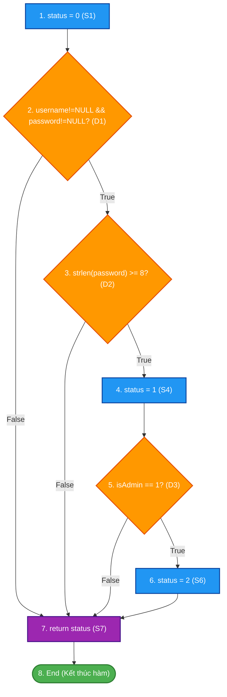
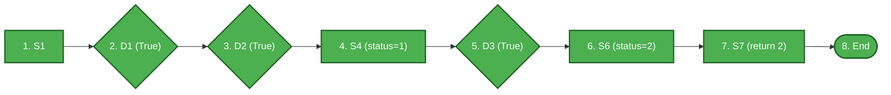
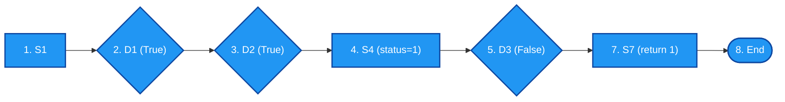
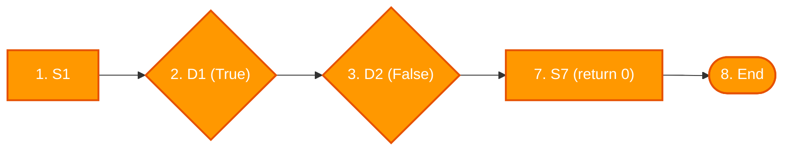
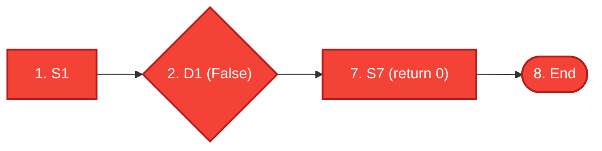

# ĐỀ THI GIỮA KỲ – MÔN KIỂM THỬ PHẦN MỀM
## **ĐỀ 03 – KỊCH BẢN 2**
### Thời gian: 60 phút | Được sử dụng tài liệu: Không

---

## CÂU 1 (6 ĐIỂM) – KIỂM THỬ HỘP ĐEN (Black-box Testing)

### Đặc tả bài toán: Hệ thống xét hạn mức tín dụng ngân hàng

Một ngân hàng xét duyệt hạn mức thẻ tín dụng dựa trên **ba tiêu chí** sau:

- **C1 – Thu nhập hàng tháng:** Từ **15 triệu VNĐ** trở lên được coi là đạt yêu cầu.
- **C2 – Lịch sử tín dụng:** Không có nợ xấu trong vòng 12 tháng gần nhất (Tốt / Có nợ xấu).
- **C3 – Thời gian làm việc tại đơn vị hiện tại:** Từ **12 tháng** trở lên (Ổn định / Chưa ổn định).

**Các mức hạn mức tín dụng được duyệt:**

| Điều kiện thỏa mãn | Hạn mức tín dụng |
|:--|:--|
| Đủ cả 3 điều kiện (C1, C2, C3) | 50.000.000 VNĐ |
| Đạt C1 và C2 (thiếu C3) | 30.000.000 VNĐ |
| Đạt C1 và C3 (thiếu C2) | 20.000.000 VNĐ |
| Chỉ đạt C1 (thiếu C2 và C3) | 10.000.000 VNĐ |
| Không đạt C1 (dù C2, C3 thế nào) | Từ chối – Không duyệt thẻ |

---

### Áp dụng kỹ thuật Kiểm thử Bảng quyết định (Decision Table Testing) (6 điểm)

**Yêu cầu:**
1. Xác định các điều kiện (Conditions) và hành động (Actions) của bài toán.
2. Xây dựng **Bảng quyết định (Decision Table)** đầy đủ với tất cả các tổ hợp điều kiện có thể. Gộp các tổ hợp có cùng kết quả nếu có thể.
3. Thiết kế **ca kiểm thử (Test Cases)** tương ứng cho mỗi quy tắc (rule) trong bảng quyết định. Ghi rõ: Mã TC, dữ liệu đầu vào (Thu nhập, Lịch sử tín dụng, Thời gian làm việc), kết quả mong đợi (Hạn mức được duyệt).

---

## CÂU 2 (4 ĐIỂM) – KIỂM THỬ HỘP TRẮNG (White-box Testing)

### Mã nguồn:

```c
int checkLogin(char* username, char* password, int isAdmin)
{
    int status = 0;
    if (username != NULL && password != NULL)
    {
        if (strlen(password) >= 8)
        {
            status = 1;
            if (isAdmin == 1)
                status = 2;
        }
    }
    return status;
}
```

> **Chú thích:** Trả về: 0 = Thất bại, 1 = Thành công (user thường), 2 = Thành công (admin).

**Yêu cầu:**
1. Vẽ Đồ thị luồng điều khiển (CFG) của hàm trên. Đánh số nút rõ ràng.
2. Tính độ phức tạp Cyclomatic V(G) bằng hai công thức khác nhau.
3. Liệt kê tất cả các **câu lệnh** và **quyết định (nhánh)** trong hàm.
4. Thiết kế bảng ca kiểm thử thỏa mãn đồng thời hai tiêu chí **Bao phủ câu lệnh (Statement Coverage)** và **Bao phủ quyết định (Decision Coverage)**. Ghi rõ: Mã TC, dữ liệu đầu vào, các câu lệnh/nhánh được bao phủ, kết quả mong đợi.

---

### Hết

---
---

# LỜI GIẢI CHI TIẾT – ĐỀ 03 KỊCH BẢN 2

---

## CÂU 1 – LỜI GIẢI (6 điểm)

### Bước 1: Xác định Điều kiện và Hành động

**Các điều kiện (Conditions):**

| Ký hiệu | Điều kiện |
|:--:|:--|
| **C1** | Thu nhập ≥ 15 triệu (T/F) |
| **C2** | Không có nợ xấu (T/F) |
| **C3** | Làm việc ≥ 12 tháng (T/F) |

**Các hành động (Actions):**

| Ký hiệu | Hành động |
|:--:|:--|
| **A1** | Hạn mức 50.000.000 VNĐ |
| **A2** | Hạn mức 30.000.000 VNĐ |
| **A3** | Hạn mức 20.000.000 VNĐ |
| **A4** | Hạn mức 10.000.000 VNĐ |
| **A5** | Từ chối – Không duyệt thẻ |

---

### Bước 2: Bảng quyết định (Decision Table)

3 điều kiện nhị phân → 2³ = 8 tổ hợp. Phân tích:

| Điều kiện / Hành động | R1 | R2 | R3 | R4 | R5–R8 (gộp) |
|:--|:--:|:--:|:--:|:--:|:--:|
| **C1: TN ≥ 15tr** | T | T | T | T | F |
| **C2: Không nợ xấu** | T | T | F | F | * |
| **C3: Làm việc ≥ 12th** | T | F | T | F | * |
| **A1: 50 triệu** | **X** | | | | |
| **A2: 30 triệu** | | **X** | | | |
| **A3: 20 triệu** | | | **X** | | |
| **A4: 10 triệu** | | | | **X** | |
| **A5: Từ chối** | | | | | **X** |

> **Ghi chú:** R5–R8 (C1=F, bất kể C2, C3) → đều từ chối. Gộp thành 1 cột đại diện.

**Bảng đầy đủ 8 rules:**

| | R1 | R2 | R3 | R4 | R5 | R6 | R7 | R8 |
|:--|:--:|:--:|:--:|:--:|:--:|:--:|:--:|:--:|
| **C1** | T | T | T | T | F | F | F | F |
| **C2** | T | T | F | F | T | T | F | F |
| **C3** | T | F | T | F | T | F | T | F |
| **A1: 50tr** | **X** | | | | | | | |
| **A2: 30tr** | | **X** | | | | | | |
| **A3: 20tr** | | | **X** | | | | | |
| **A4: 10tr** | | | | **X** | | | | |
| **A5: Từ chối** | | | | | **X** | **X** | **X** | **X** |

---

### Bước 3: Bảng ca kiểm thử

| TC ID | Thu nhập (tr/th) | Lịch sử tín dụng | Thời gian làm việc | Rule | Kết quả mong đợi |
|:--:|:--:|:--:|:--:|:--:|:--|
| **TC01** | 20 triệu | Không nợ xấu | 24 tháng | R1 | Hạn mức: **50.000.000 VNĐ** |
| **TC02** | 18 triệu | Không nợ xấu | 8 tháng | R2 | Hạn mức: **30.000.000 VNĐ** |
| **TC03** | 16 triệu | Có nợ xấu | 18 tháng | R3 | Hạn mức: **20.000.000 VNĐ** |
| **TC04** | 15 triệu | Có nợ xấu | 6 tháng | R4 | Hạn mức: **10.000.000 VNĐ** |
| **TC05** | 10 triệu | Không nợ xấu | 24 tháng | R5 | **Từ chối** – Không đủ thu nhập |
| **TC06** | 12 triệu | Không nợ xấu | 5 tháng | R6 | **Từ chối** – Không đủ thu nhập |
| **TC07** | 8 triệu | Có nợ xấu | 20 tháng | R7 | **Từ chối** – Không đủ thu nhập |
| **TC08** | 5 triệu | Có nợ xấu | 3 tháng | R8 | **Từ chối** – Không đủ thu nhập |

---

## CÂU 2 – LỜI GIẢI (4 điểm)

### Bước 1: Đánh số câu lệnh và xác định các nút trong Đồ thị luồng điều khiển (CFG)

Mã nguồn hàm `checkLogin(char *username, char *password, int isAdmin)` được phân tách thành các nút đồ thị:
- **Nút 1:** `int status = 0;` *(Câu lệnh S1: Khởi tạo trạng thái mặc định)*
- **Nút 2:** `if (username != NULL && password != NULL)` *(Quyết định D1: Kiểm tra tài khoản mật khẩu không rỗng)*
- **Nút 3:** `if (strlen(password) >= 8)` *(Quyết định D2: Kiểm tra độ dài tối thiểu của mật khẩu)*
- **Nút 4:** `status = 1;` *(Câu lệnh S4: Gán đăng nhập thành công quyền User)*
- **Nút 5:** `if (isAdmin == 1)` *(Quyết định D3: Kiểm tra quyền quản trị viên Admin)*
- **Nút 6:** `status = 2;` *(Câu lệnh S6: Nâng quyền Admin)*
- **Nút 7:** `return status;` *(Câu lệnh S7: Trả về trạng thái đăng nhập)*
- **Nút 8:** `End / Exit` *(Điểm kết thúc hàm)*

---

### Sơ đồ Đồ thị luồng điều khiển (CFG) tổng quát



---

### Bước 2: Tính độ phức tạp Cyclomatic $V(G)$

Thống kê các thành phần của đồ thị luồng điều khiển $G$:
- **Số nút ($N$):** $8$ (từ Nút 1 đến Nút 8)
- **Số cung ($E$):** $10$
  - Các cung: $(1\to2)$, $(2\to3)$, $(2\to7)$, $(3\to4)$, $(3\to7)$, $(4\to5)$, $(5\to6)$, $(5\to7)$, $(6\to7)$, $(7\to8)$
- **Số nút vị từ phân nhánh ($P$):** $3$ nút điều kiện (Nút 2, Nút 3, Nút 5)

Áp dụng 2 công thức chuẩn theo giáo trình:
- **Công thức 1 (Theo số cung và số nút):**
  $$V(G) = E - N + 2 = 10 - 8 + 2 = 4$$
- **Công thức 2 (Theo số nút vị từ $P$):**
  $$V(G) = P + 1 = 3 + 1 = 4$$

*(Kiểm chứng theo số miền phẳng $R$: Đồ thị có 3 miền khép kín và 1 miền mở vô hạn bao quanh $\implies V(G) = R = 4$)*.

> **Kết luận:** Độ phức tạp Cyclomatic $V(G) = 4$. Cần tối thiểu **4 ca kiểm thử** để bao phủ toàn bộ câu lệnh và quyết định.

---

### Bước 3: Sơ đồ hóa từng đường thi hành (Statement & Decision Coverage Paths)

#### 🔹 Đường P1: Đăng nhập thành công với quyền Admin (Phủ S1, S2, S3, S4, S5, S6, S7)
- **Đường đi:** $1 \to 2(\text{True}) \to 3(\text{True}) \to 4 \to 5(\text{True}) \to 6 \to 7 \to 8$
- **Đặc điểm:** Bao phủ nhánh `True` của D1, D2, D3; thực thi toàn bộ các câu lệnh gán status = 1 và status = 2; trả về `status = 2`.



#### 🔹 Đường P2: Đăng nhập thành công với quyền User thường (Phủ nhánh False của D3)
- **Đường đi:** $1 \to 2(\text{True}) \to 3(\text{True}) \to 4 \to 5(\text{False}) \to 7 \to 8$
- **Đặc điểm:** Bao phủ nhánh `True` của D1, D2 và nhánh `False` của D3; giữ nguyên `status = 1`; trả về `status = 1`.



#### 🔹 Đường P3: Mật khẩu quá ngắn (Phủ nhánh False của D2)
- **Đường đi:** $1 \to 2(\text{True}) \to 3(\text{False}) \to 7 \to 8$
- **Đặc điểm:** Bao phủ nhánh `True` của D1 và nhánh `False` của D2; bỏ qua toàn bộ khối gán status; trả về `status = 0`.



#### 🔹 Đường P4: Dữ liệu tài khoản/mật khẩu bị NULL (Phủ nhánh False của D1)
- **Đường đi:** $1 \to 2(\text{False}) \to 7 \to 8$
- **Đặc điểm:** Bao phủ nhánh `False` của D1; trực tiếp nhảy về return; trả về `status = 0`.



---

### Bước 4: Ma trận bao phủ Câu lệnh và Quyết định (Coverage Matrix)

#### Bảng đối soát Statement Coverage (Bao phủ câu lệnh):

| Câu lệnh (Statement) | Nội dung câu lệnh | P1 | P2 | P3 | P4 | Mức độ bao phủ |
|:---:|:---|:---:|:---:|:---:|:---:|:---:|
| **S1** (Nút 1) | `status = 0` | ✓ | ✓ | ✓ | ✓ | 100% |
| **S2** (Nút 2) | `if (username != NULL && password != NULL)` | ✓ | ✓ | ✓ | ✓ | 100% |
| **S3** (Nút 3) | `if (strlen(password) >= 8)` | ✓ | ✓ | ✓ | | 100% |
| **S4** (Nút 4) | `status = 1` | ✓ | ✓ | | | 100% |
| **S5** (Nút 5) | `if (isAdmin == 1)` | ✓ | ✓ | | | 100% |
| **S6** (Nút 6) | `status = 2` | ✓ | | | | 100% |
| **S7** (Nút 7) | `return status` | ✓ | ✓ | ✓ | ✓ | 100% |

#### Bảng đối soát Decision Coverage (Bao phủ quyết định / nhánh):

| Quyết định | Nhánh True được phủ bởi | Nhánh False được phủ bởi | Đạt Decision Coverage |
|:---:|:---:|:---:|:---:|
| **D1** (Nút 2) | TC01, TC02, TC03 (P1, P2, P3) | TC04 (P4) | ✅ 100% |
| **D2** (Nút 3) | TC01, TC02 (P1, P2) | TC03 (P3) | ✅ 100% |
| **D3** (Nút 5) | TC01 (P1) | TC02 (P2) | ✅ 100% |

---

### Bước 5: Bảng ca kiểm thử hộp trắng (Statement & Decision Coverage Test Cases)

| TC ID | Mục tiêu kiểm thử | `username` | `password` | `isAdmin` | Luồng câu lệnh thực thi | Nhánh quyết định (D1, D2, D3) | Kết quả mong đợi (`status`) |
|:---:|:---|:---|:---|:---:|:---|:---:|:---:|
| **TC01** | Phủ toàn bộ câu lệnh, quyền Admin | `"admin"` | `"pass12345"` | 1 | S1, S2, S3, S4, S5, S6, S7 | D1=T, D2=T, D3=T | `2`<br>(Admin thành công) |
| **TC02** | Phủ quyền User thường (D3 False) | `"user01"` | `"pass12345"` | 0 | S1, S2, S3, S4, S5, S7 | D1=T, D2=T, D3=F | `1`<br>(User thành công) |
| **TC03** | Phủ mật khẩu ngắn < 8 ký tự (D2 False) | `"user01"` | `"abc"` | 0 | S1, S2, S3, S7 | D1=T, D2=F | `0`<br>(Đăng nhập thất bại) |
| **TC04** | Phủ dữ liệu NULL (D1 False) | `NULL` | `NULL` | 0 | S1, S2, S7 | D1=F | `0`<br>(Đăng nhập thất bại) |

---

> **Tổng kết thang điểm đạt được:**
> - **Vẽ sơ đồ CFG:** 1.0 điểm – Đầy đủ nút, nhánh rẽ điều kiện và điểm hội tụ rõ ràng.
> - **Tính Cyclomatic Complexity $V(G)$:** 1.0 điểm – Trình bày đủ 2 công thức $E - N + 2 = 10 - 8 + 2 = 4$ và $P + 1 = 3 + 1 = 4$.
> - **Phân tích và sơ đồ hóa Statement & Decision Coverage:** 1.0 điểm – Sơ đồ hóa từng đường, ma trận kiểm chứng S1–S7 và D1–D3 đầy đủ.
> - **Thiết kế bảng Ca kiểm thử (Test Cases):** 1.0 điểm – Dữ liệu chuỗi rõ ràng, vết câu lệnh thực thi và kết quả trả về chính xác.
