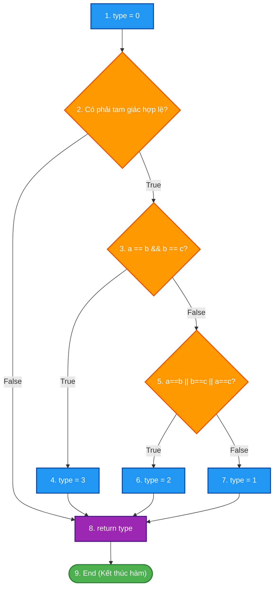
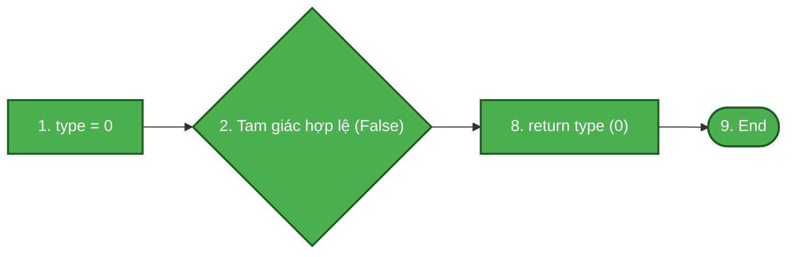
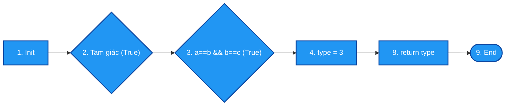
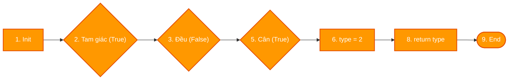
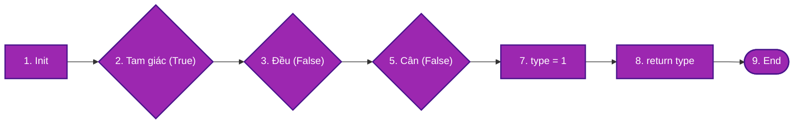

# ĐỀ THI KẾT THÚC HỌC PHẦN: KIỂM THỬ PHẦN MỀM
**Mã đề thi:** KB3_De01  
**Thời gian làm bài:** 60 – 75 phút *(Không sử dụng tài liệu)*  
**Hình thức:** Tự luận trên giấy / nộp bài giải chi tiết  
**Cấu trúc điểm:** Câu 1 (6.0 điểm) + Câu 2 (4.0 điểm) = 10.0 điểm  

---

## CÂU 1: KIỂM THỬ HỘP ĐEN – KỸ THUẬT KIỂM THỬ THEO CẶP (PAIRWISE TESTING) (6.0 điểm)

Một ứng dụng quản lý bán hàng xe trực tuyến có Form đăng ký chọn cấu hình xe cần kiểm thử trước khi bàn giao. Form bao gồm 4 trường thông tin lựa chọn độc lập:

1. **Hãng xe (A):** {Vinfast, Toyota, Yamaha} *(3 mức giá trị)*
2. **Loại xe (B):** {Xe máy, Xe 4 chỗ, Xe 7 chỗ} *(3 mức giá trị)*
3. **Xuất xứ (C):** {Việt Nam, Nhật Bản, Đài Loan} *(3 mức giá trị)*
4. **Màu sơn (D):** {Đen, Xanh, Vàng} *(3 mức giá trị)*

**Yêu cầu:**

1. *(1.0 điểm)* Tính tổng số lượng ca kiểm thử nếu thực hiện **Kiểm thử vét cạn (Exhaustive Testing - tích Descartes)** cho tất cả các tổ hợp có thể xảy ra.
2. *(1.0 điểm)* Giải thích nguyên lý của kỹ thuật **Kiểm thử theo cặp (Pairwise Testing / All-Pairs Testing)**. Tính tổng số cặp giá trị cần phải bao phủ giữa các biến.
3. *(2.5 điểm)* Áp dụng mảng trực giao $L_9(3^4)$ để thiết kế tập ca kiểm thử tối ưu theo phương pháp Pairwise Testing. Trình bày bảng ca kiểm thử gồm: Mã TC, Hãng xe, Loại xe, Xuất xứ, Màu sơn.
4. *(1.5 điểm)* Lập bảng ma trận đối soát kiểm chứng chứng minh rằng mọi cặp 2 tham số đều xuất hiện ít nhất một lần trong tập ca kiểm thử vừa thiết kế.

---

## CÂU 2: KIỂM THỬ HỘP TRẮNG – PHƯƠNG PHÁP KIỂM THỬ ĐƯỜNG CƠ BẢN (4.0 điểm)

Cho hàm xác định loại tam giác `checkTriangle` viết bằng ngôn ngữ C như sau:

```c
int checkTriangle(int a, int b, int c)
{
    int type = 0; // 0: Không phải tam giác, 1: Thường, 2: Cân, 3: Đều
    if (a > 0 && b > 0 && c > 0 && (a + b > c) && (a + c > b) && (b + c > a))
    {
        if (a == b && b == c)
            type = 3; // Tam giác đều
        else if (a == b || b == c || a == c)
            type = 2; // Tam giác cân
        else
            type = 1; // Tam giác thường
    }
    return type;
}
```

**Yêu cầu:**

1. *(1.0 điểm)* Vẽ **Đồ thị luồng điều khiển (CFG)** của đoạn mã trên. Đánh số các nút rõ ràng.
2. *(1.0 điểm)* Tính độ phức tạp Cyclomatic $V(G)$ bằng hai công thức khác nhau.
3. *(1.0 điểm)* Xác định và sơ đồ hóa tập các **đường thi hành cơ sở (Basis Paths)** độc lập tuyến tính.
4. *(1.0 điểm)* Thiết kế bảng ca kiểm thử tương ứng cho từng đường thi hành (ghi rõ Mã TC, dữ liệu đầu vào $a, b, c$, vết luồng đi qua các nút, kết quả mong đợi).

---
### HẾT PHẦN ĐỀ BÀI
---

# LỜI GIẢI CHI TIẾT – ĐỀ 01 KỊCH BẢN 3

---

## CÂU 1 – LỜI GIẢI (6.0 điểm)

### 1. Số lượng ca kiểm thử theo phương pháp vét cạn (1.0 điểm)
Form gồm 4 tham số độc lập, mỗi tham số có 3 giá trị:
- Số giá trị của Hãng xe: $N_A = 3$
- Số giá trị của Loại xe: $N_B = 3$
- Số giá trị của Xuất xứ: $N_C = 3$
- Số giá trị của Màu sơn: $N_D = 3$

Số lượng ca kiểm thử vét cạn theo tích Descartes là:
$$N_{\text{total}} = N_A \times N_B \times N_C \times N_D = 3 \times 3 \times 3 \times 3 = 3^4 = 81 \text{ ca kiểm thử}$$

> **Nhận xét:** 81 ca kiểm thử là quá nhiều và gây tốn kém thời gian, chi phí kiểm thử đối với một form nhập liệu đơn giản.

---

### 2. Nguyên lý Pairwise Testing và số lượng cặp cần bao phủ (1.0 điểm)
- **Nguyên lý Pairwise Testing (All-Pairs Testing):** Phần lớn lỗi phần mềm (khoảng 70% – 90%) là lỗi đơn lẻ hoặc lỗi phát sinh do sự tương tác giữa 2 tham số đầu vào (cặp đôi). Kỹ thuật Pairwise kiểm thử mọi tổ hợp cặp đôi của các giá trị tham số ít nhất một lần, giúp giảm mạnh số ca kiểm thử từ $81$ xuống chỉ còn $9$ ca kiểm thử mà vẫn bảo đảm phát hiện hầu hết các lỗi tương tác.
- **Tổng số cặp giữa các biến:**
  Với 4 biến $A, B, C, D$, số cách chọn 2 biến bất kỳ là $C_4^2 = \frac{4 \times 3}{2} = 6$ cặp biến:
  $$(A, B), (A, C), (A, D), (B, C), (B, D), (C, D)$$
  Mỗi cặp biến gồm $3 \times 3 = 9$ tổ hợp giá trị.
  $$\implies \text{Tổng số cặp giá trị cần bao phủ} = 6 \times 9 = 54 \text{ cặp}$$

---

### 3. Thiết kế bảng ca kiểm thử Pairwise bằng mảng trực giao $L_9(3^4)$ (2.5 điểm)

Quy ước mã hóa các mức giá trị:
- **Hãng xe (A):** 1 = Vinfast, 2 = Toyota, 3 = Yamaha
- **Loại xe (B):** 1 = Xe máy, 2 = Xe 4 chỗ, 3 = Xe 7 chỗ
- **Xuất xứ (C):** 1 = Việt Nam, 2 = Nhật Bản, 3 = Đài Loan
- **Màu sơn (D):** 1 = Đen, 2 = Xanh, 3 = Vàng

Áp dụng mảng trực giao chuẩn $L_9(3^4)$:

| TC ID | A (Hãng xe) | B (Loại xe) | C (Xuất xứ) | D (Màu sơn) | Kết quả kỳ vọng |
|:---:|:---|:---|:---|:---|:---|
| **TC01** | Vinfast | Xe máy | Việt Nam | Đen | Đăng ký thành công xe Vinfast máy VN Đen |
| **TC02** | Vinfast | Xe 4 chỗ | Nhật Bản | Xanh | Đăng ký thành công xe Vinfast 4 chỗ NB Xanh |
| **TC03** | Vinfast | Xe 7 chỗ | Đài Loan | Vàng | Đăng ký thành công xe Vinfast 7 chỗ ĐL Vàng |
| **TC04** | Toyota | Xe máy | Nhật Bản | Vàng | Đăng ký thành công xe Toyota máy NB Vàng |
| **TC05** | Toyota | Xe 4 chỗ | Đài Loan | Đen | Đăng ký thành công xe Toyota 4 chỗ ĐL Đen |
| **TC06** | Toyota | Xe 7 chỗ | Việt Nam | Xanh | Đăng ký thành công xe Toyota 7 chỗ VN Xanh |
| **TC07** | Yamaha | Xe máy | Đài Loan | Xanh | Đăng ký thành công xe Yamaha máy ĐL Xanh |
| **TC08** | Yamaha | Xe 4 chỗ | Việt Nam | Vàng | Đăng ký thành công xe Yamaha 4 chỗ VN Vàng |
| **TC09** | Yamaha | Xe 7 chỗ | Nhật Bản | Đen | Đăng ký thành công xe Yamaha 7 chỗ NB Đen |

---

### 4. Ma trận đối soát kiểm chứng bao phủ cặp (1.5 điểm)

Kiểm tra sự xuất hiện của các cặp giữa biến Hãng xe ($A$) và Loại xe ($B$):
- (Vinfast, Máy): TC01
- (Vinfast, 4 chỗ): TC02
- (Vinfast, 7 chỗ): TC03
- (Toyota, Máy): TC04
- (Toyota, 4 chỗ): TC05
- (Toyota, 7 chỗ): TC06
- (Yamaha, Máy): TC07
- (Yamaha, 4 chỗ): TC08
- (Yamaha, 7 chỗ): TC09
$\implies$ Đạt bao phủ 9/9 cặp (100%).

Tương tự kiểm tra giữa $A$ và $C$, $A$ và $D$, $B$ và $C$, $B$ và $D$, $C$ và $D$: Tất cả $6 \times 9 = 54$ cặp đều xuất hiện chính xác 1 lần trong 9 ca kiểm thử.
$$\text{Tỷ lệ bao phủ cặp (Pairwise Coverage)} = \frac{54}{54} = 100\%$$

---

## CÂU 2 – LỜI GIẢI (4.0 điểm)

### Bước 1: Đánh số câu lệnh và xác định các nút trong Đồ thị luồng điều khiển (CFG)

- **Nút 1:** `int type = 0;` *(Khởi tạo kết quả mặc định)*
- **Nút 2:** `if (a > 0 && b > 0 && c > 0 && a+b>c && a+c>b && b+c>a)` *(Vị từ kiểm tra điều kiện tam giác)*
- **Nút 3:** `if (a == b && b == c)` *(Vị từ kiểm tra tam giác đều)*
- **Nút 4:** `type = 3;` *(Gán tam giác đều)*
- **Nút 5:** `else if (a == b || b == c || a == c)` *(Vị từ kiểm tra tam giác cân)*
- **Nút 6:** `type = 2;` *(Gán tam giác cân)*
- **Nút 7:** `type = 1;` *(Gán tam giác thường)*
- **Nút 8:** `return type;` *(Trả về kết quả loại tam giác)*
- **Nút 9:** `End / Exit` *(Điểm kết thúc hàm)*

---

### Sơ đồ Đồ thị luồng điều khiển (CFG) tổng quát



---

### Bước 2: Tính độ phức tạp Cyclomatic $V(G)$

Thống kê các thành phần của đồ thị luồng điều khiển $G$:
- **Số nút ($N$):** $9$ (Nút 1 đến Nút 9)
- **Số cung ($E$):** $11$ gồm: $(1\to2)$, $(2\to3)$, $(2\to8)$, $(3\to4)$, $(3\to5)$, $(4\to8)$, $(5\to6)$, $(5\to7)$, $(6\to8)$, $(7\to8)$, $(8\to9)$
- **Số nút vị từ phân nhánh ($P$):** $3$ nút điều kiện (Nút 2, Nút 3, Nút 5)

Áp dụng 2 công thức:
- **Công thức 1 (Theo số cung và số nút):**
  $$V(G) = E - N + 2 = 11 - 9 + 2 = 4$$
- **Công thức 2 (Theo số nút vị từ $P$):**
  $$V(G) = P + 1 = 3 + 1 = 4$$

*(Kiểm chứng theo số miền phẳng $R$: Đồ thị có 3 miền đóng và 1 miền mở vô hạn bao quanh $\implies V(G) = R = 4$)*.

> **Kết luận:** Độ phức tạp Cyclomatic $V(G) = 4$. Cần tối thiểu **4 đường thi hành cơ sở (Basis Paths)** độc lập tuyến tính để bao phủ kiểm thử.

---

### Bước 3: Sơ đồ hóa từng đường thi hành cơ sở (Basis Paths)

#### 🔹 Đường 1 (P1): Ba cạnh không tạo thành tam giác hợp lệ
- **Đường đi:** $1 \to 2(\text{False}) \to 8 \to 9$
- **Đặc điểm:** Bao phủ nhánh `False` của Nút 2; trả về `type = 0`.



#### 🔹 Đường 2 (P2): Tam giác đều ($a = b = c$)
- **Đường đi:** $1 \to 2(\text{True}) \to 3(\text{True}) \to 4 \to 8 \to 9$
- **Đặc điểm:** Bao phủ nhánh `True` của Nút 2 và nhánh `True` của Nút 3; gán `type = 3`.



#### 🔹 Đường 3 (P3): Tam giác cân ($a = b \ne c$)
- **Đường đi:** $1 \to 2(\text{True}) \to 3(\text{False}) \to 5(\text{True}) \to 6 \to 8 \to 9$
- **Đặc điểm:** Bao phủ nhánh `False` của Nút 3 và nhánh `True` của Nút 5; gán `type = 2`.



#### 🔹 Đường 4 (P4): Tam giác thường (3 cạnh khác nhau)
- **Đường đi:** $1 \to 2(\text{True}) \to 3(\text{False}) \to 5(\text{False}) \to 7 \to 8 \to 9$
- **Đặc điểm:** Bao phủ nhánh `False` của cả Nút 3 và Nút 5; gán `type = 1`.



---

### Bước 4: Ma trận bao phủ các cung (Branch / Edge Coverage Matrix)

| Cung (Edge) | Nhãn nhánh | P1 | P2 | P3 | P4 | Mức độ bao phủ |
|:---:|:---|:---:|:---:|:---:|:---:|:---:|
| **e1** ($1 \to 2$) | Khởi tạo vào kiểm tra tam giác | ✓ | ✓ | ✓ | ✓ | 100% |
| **e2** ($2 \to 3$) | Nhánh là tam giác = True | | ✓ | ✓ | ✓ | 100% |
| **e3** ($2 \to 8$) | Nhánh là tam giác = False | ✓ | | | | 100% |
| **e4** ($3 \to 4$) | Nhánh tam giác đều = True | | ✓ | | | 100% |
| **e5** ($3 \to 5$) | Nhánh tam giác đều = False | | | ✓ | ✓ | 100% |
| **e6** ($4 \to 8$) | Gán type = 3 đến return | | ✓ | | | 100% |
| **e7** ($5 \to 6$) | Nhánh tam giác cân = True | | | ✓ | | 100% |
| **e8** ($5 \to 7$) | Nhánh tam giác cân = False | | | | ✓ | 100% |
| **e9** ($6 \to 8$) | Gán type = 2 đến return | | | ✓ | | 100% |
| **e10** ($7 \to 8$) | Gán type = 1 đến return | | | | ✓ | 100% |
| **e11** ($8 \to 9$) | Trả về type đến kết thúc hàm | ✓ | ✓ | ✓ | ✓ | 100% |

---

### Bước 5: Bảng ca kiểm thử hộp trắng (Basis Path Testing Test Cases)

| TC ID | Mục tiêu kiểm thử | Dữ liệu đầu vào ($a, b, c$) | Luồng thực thi qua các nút | Kết quả mong đợi (`type`) | Tiêu chí bao phủ đạt được |
|:---:|:---|:---:|:---|:---:|:---|
| **TC_P1** | Phủ đường P1 (Không phải tam giác) | $a = 1, b = 2, c = 5$<br>*(1 + 2 < 5)* | $1 \to 2(F) \to 8 \to 9$ | `0` (Không phải TG) | Nhánh False Nút 2, cung $2 \to 8$ |
| **TC_P2** | Phủ đường P2 (Tam giác đều) | $a = 4, b = 4, c = 4$ | $1 \to 2(T) \to 3(T) \to 4 \to 8 \to 9$ | `3` (Tam giác đều) | Nhánh True Nút 3, câu lệnh Nút 4 |
| **TC_P3** | Phủ đường P3 (Tam giác cân) | $a = 4, b = 4, c = 5$ | $1 \to 2(T) \to 3(F) \to 5(T) \to 6 \to 8 \to 9$ | `2` (Tam giác cân) | Nhánh True Nút 5, câu lệnh Nút 6 |
| **TC_P4** | Phủ đường P4 (Tam giác thường) | $a = 3, b = 4, c = 5$ | $1 \to 2(T) \to 3(F) \to 5(F) \to 7 \to 8 \to 9$ | `1` (Tam giác thường) | Nhánh False Nút 5, câu lệnh Nút 7 |

---

> **Tổng kết thang điểm đạt được:**
> - **Câu 1 (Kiểm thử theo cặp - Pairwise):** 6.0 điểm – Tính đúng vét cạn (1đ), nêu rõ nguyên lý & số cặp (1đ), bảng mảng trực giao $L_9(3^4)$ đủ 9 TC (2.5đ), ma trận đối soát phủ 100% (1.5đ).
> - **Câu 2 (Hộp trắng – Basis Path):** 4.0 điểm – CFG đúng (1đ), V(G)=4 bằng 2 công thức (1đ), 4 Basis Paths có sơ đồ minh họa trực quan (1đ), bảng TC đúng (1đ).
