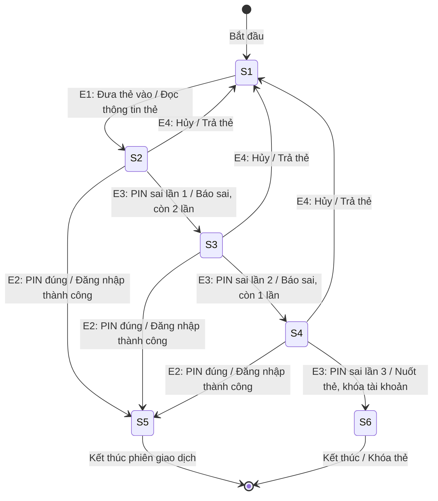
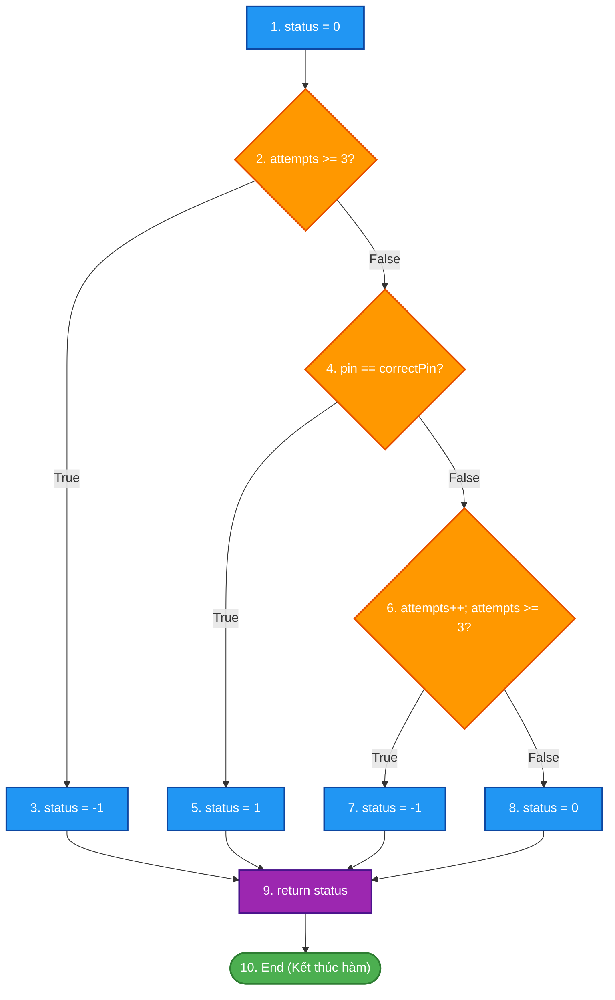
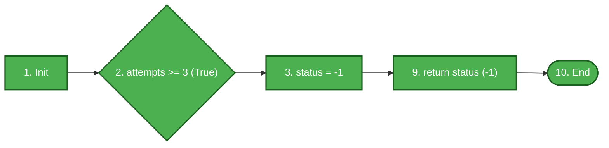
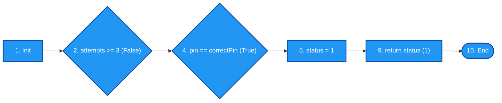
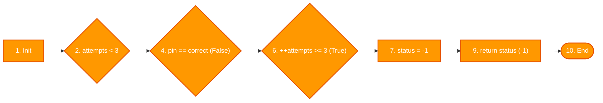
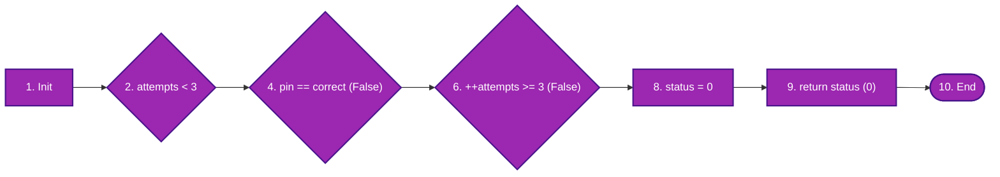

# ĐỀ THI KẾT THÚC HỌC PHẦN: KIỂM THỬ PHẦN MỀM
**Mã đề thi:** KB3_De02  
**Thời gian làm bài:** 60 – 75 phút *(Không sử dụng tài liệu)*  
**Hình thức:** Tự luận trên giấy / nộp bài giải chi tiết  
**Cấu trúc điểm:** Câu 1 (6.0 điểm) + Câu 2 (4.0 điểm) = 10.0 điểm  

---

## CÂU 1: KIỂM THỬ HỘP ĐEN – KỸ THUẬT KIỂM THỬ CHUYỂN TRẠNG THÁI (STATE TRANSITION TESTING) (6.0 điểm)

Hệ thống cây ATM của một ngân hàng thực hiện xác thực mã số cá nhân (PIN) của khách hàng với quy tắc nghiệp vụ như sau:

- Ban đầu máy ở trạng thái **Chờ đưa thẻ ($S_1$)**. Khi khách hàng đưa thẻ vào khe đọc, hệ thống chuyển sang trạng thái **Chờ nhập PIN lần 1 ($S_2$)**.
- Tại trạng thái $S_2$, khách hàng có thể bấm "Hủy giao dịch" để nhận lại thẻ và máy quay về $S_1$. Nếu nhập đúng mã PIN, hệ thống chuyển sang trạng thái **Đăng nhập thành công ($S_5$)** và cho phép thực hiện giao dịch. Nếu nhập sai mã PIN lần 1, máy hiển thị thông báo lỗi và chuyển sang trạng thái **Chờ nhập PIN lần 2 ($S_3$)**.
- Tại $S_3$, nếu bấm "Hủy" thì trả lại thẻ và quay về $S_1$. Nếu nhập đúng PIN, chuyển sang $S_5$. Nếu nhập sai lần 2, chuyển sang trạng thái **Chờ nhập PIN lần 3 ($S_4$)**.
- Tại $S_4$, nếu bấm "Hủy" thì trả lại thẻ và quay về $S_1$. Nếu nhập đúng PIN, chuyển sang $S_5$. Nếu nhập sai mã PIN lần thứ 3, hệ thống lập tức chuyển sang trạng thái **Khóa / Nuốt thẻ ($S_6$)**, hiển thị cảnh báo và kết thúc phiên.

**Yêu cầu:**

1. *(1.5 điểm)* Xác định tập các trạng thái ($S$), các sự kiện kích hoạt ($E$) và hành động đầu ra ($A$). Vẽ **Sơ đồ chuyển trạng thái (State Transition Diagram)** trực quan của hệ thống.
2. *(1.5 điểm)* Xây dựng **Bảng chuyển trạng thái (State Transition Table)** thể hiện đầy đủ trạng thái hiện tại, sự kiện, trạng thái kế tiếp và hành động tương ứng (bao gồm cả các chuyển tiếp không hợp lệ / bất khả thi).
3. *(1.5 điểm)* Áp dụng tiêu chí **Bao phủ chuyển tiếp mức 0 (0-Switch / 1-Transition Coverage)** để xác định tập các chuỗi chuyển tiếp kiểm thử cần thiết.
4. *(1.5 điểm)* Thiết kế **Bảng ca kiểm thử chuyển trạng thái** hoàn chỉnh (ghi rõ Mã TC, Trạng thái bắt đầu, Chuỗi sự kiện đầu vào, Trạng thái kết thúc kỳ vọng, Kết quả/Hành động mong đợi).

---

## CÂU 2: KIỂM THỬ HỘP TRẮNG – PHƯƠNG PHÁP KIỂM THỬ ĐƯỜNG CƠ BẢN (4.0 điểm)

Cho hàm xử lý số lần thử mã PIN `checkPinAttempts` viết bằng ngôn ngữ C như sau:

```c
int checkPinAttempts(int pin, int correctPin, int attempts)
{
    int status = 0; // 0: Thử lại, 1: Thành công, -1: Khóa thẻ
    if (attempts >= 3)
    {
        status = -1;
    }
    else if (pin == correctPin)
    {
        status = 1;
    }
    else
    {
        attempts++;
        if (attempts >= 3)
            status = -1;
        else
            status = 0;
    }
    return status;
}
```

**Yêu cầu:**

1. *(1.0 điểm)* Vẽ **Đồ thị luồng điều khiển (CFG)** của đoạn mã trên. Đánh số các nút rõ ràng.
2. *(1.0 điểm)* Tính độ phức tạp Cyclomatic $V(G)$ bằng hai công thức khác nhau.
3. *(1.0 điểm)* Liệt kê và sơ đồ hóa tập các **đường thi hành cơ sở (Basis Paths)** độc lập tuyến tính.
4. *(1.0 điểm)* Thiết kế bảng ca kiểm thử tương ứng cho từng đường thi hành (ghi rõ Mã TC, dữ liệu đầu vào `pin`, `correctPin`, `attempts`, vết luồng đi qua các nút, kết quả mong đợi `status`).

---
### HẾT PHẦN ĐỀ BÀI
---

# LỜI GIẢI CHI TIẾT – ĐỀ 02 KỊCH BẢN 3

---

## CÂU 1 – LỜI GIẢI (6.0 điểm)

### 1. Xác định Trạng thái, Sự kiện và Sơ đồ chuyển trạng thái (1.5 điểm)

**Tập các trạng thái ($S$):**
- **$S_1$:** Chờ đưa thẻ (Idle / Wait for Card) - Trạng thái ban đầu
- **$S_2$:** Chờ nhập PIN lần 1 (Wait for PIN - Attempt 1)
- **$S_3$:** Chờ nhập PIN lần 2 (Wait for PIN - Attempt 2)
- **$S_4$:** Chờ nhập PIN lần 3 (Wait for PIN - Attempt 3)
- **$S_5$:** Đăng nhập thành công (Access Granted) - Trạng thái kết thúc hợp lệ
- **$S_6$:** Khóa / Nuốt thẻ (Card Blocked / Retained) - Trạng thái kết thúc lỗi

**Tập các sự kiện ($E$):**
- **$E_1$:** Đưa thẻ vào khe (Insert Card)
- **$E_2$:** Nhập mã PIN đúng (Valid PIN)
- **$E_3$:** Nhập mã PIN sai (Invalid PIN)
- **$E_4$:** Bấm nút Hủy giao dịch (Cancel)

**Sơ đồ chuyển trạng thái (State Transition Diagram) bằng Mermaid:**



---

### 2. Bảng chuyển trạng thái (State Transition Table) (1.5 điểm)

Bảng biểu diễn quan hệ: $(\text{Trạng thái hiện tại}, \text{Sự kiện}) \to (\text{Trạng thái kế tiếp}, \text{Hành động})$. Các ô dấu `-` biểu thị chuyển tiếp không hợp lệ / không thể xảy ra.

| Trạng thái hiện tại | Sự kiện: Đưa thẻ ($E_1$) | Sự kiện: PIN đúng ($E_2$) | Sự kiện: PIN sai ($E_3$) | Sự kiện: Hủy ($E_4$) |
|:---|:---|:---|:---|:---|
| **$S_1$ (Chờ thẻ)** | $\to S_2$ (Đọc thẻ) | - | - | - |
| **$S_2$ (Chờ PIN 1)** | - | $\to S_5$ (Vào Menu) | $\to S_3$ (Báo sai L1) | $\to S_1$ (Trả thẻ) |
| **$S_3$ (Chờ PIN 2)** | - | $\to S_5$ (Vào Menu) | $\to S_4$ (Báo sai L2) | $\to S_1$ (Trả thẻ) |
| **$S_4$ (Chờ PIN 3)** | - | $\to S_5$ (Vào Menu) | $\to S_6$ (Nuốt thẻ) | $\to S_1$ (Trả thẻ) |
| **$S_5$ (Đăng nhập)** | - | - | - | $\to S_1$ (Đăng xuất, trả thẻ) |
| **$S_6$ (Nuốt thẻ)** | - | - | - | - |

---

### 3. Xác định tập chuyển tiếp theo tiêu chí 0-Switch Coverage (1.5 điểm)

Tiêu chí **0-Switch Coverage** (Bao phủ chuyển tiếp đơn): Mọi chuyển tiếp hợp lệ giữa 2 trạng thái kế nhau phải được thực thi ít nhất một lần.

Danh sách các chuyển tiếp hợp lệ cần bao phủ:
1. $T_1: S_1 \xrightarrow{E_1} S_2$ (Đưa thẻ vào)
2. $T_2: S_2 \xrightarrow{E_2} S_5$ (Nhập đúng PIN lần 1)
3. $T_3: S_2 \xrightarrow{E_4} S_1$ (Hủy tại lần 1)
4. $T_4: S_2 \xrightarrow{E_3} S_3$ (Nhập sai PIN lần 1)
5. $T_5: S_3 \xrightarrow{E_2} S_5$ (Nhập đúng PIN lần 2)
6. $T_6: S_3 \xrightarrow{E_4} S_1$ (Hủy tại lần 2)
7. $T_7: S_3 \xrightarrow{E_3} S_4$ (Nhập sai PIN lần 2)
8. $T_8: S_4 \xrightarrow{E_2} S_5$ (Nhập đúng PIN lần 3)
9. $T_9: S_4 \xrightarrow{E_4} S_1$ (Hủy tại lần 3)
10. $T_{10}: S_4 \xrightarrow{E_3} S_6$ (Nhập sai PIN lần 3 $\implies$ Nuốt thẻ)

---

### 4. Bảng ca kiểm thử chuyển trạng thái hoàn chỉnh (1.5 điểm)

| TC ID | Mục tiêu kiểm thử | Trạng thái ban đầu | Chuỗi sự kiện đầu vào | Chuyển tiếp bao phủ | Trạng thái đích | Kết quả mong đợi |
|:---:|:---|:---:|:---|:---:|:---:|:---|
| **ST01** | Đăng nhập thành công ngay lần đầu | $S_1$ | Đưa thẻ $\to$ Nhập đúng PIN | $T_1, T_2$ | $S_5$ | Vào màn hình giao dịch tài khoản |
| **ST02** | Hủy giao dịch tại lần nhập đầu | $S_1$ | Đưa thẻ $\to$ Bấm Hủy | $T_1, T_3$ | $S_1$ | Nhả thẻ, màn hình trở về chờ thẻ |
| **ST03** | Sai lần 1, đúng lần 2 thành công | $S_1$ | Đưa thẻ $\to$ Nhập sai PIN $\to$ Nhập đúng PIN | $T_1, T_4, T_5$ | $S_5$ | Báo sai L1; sau đó vào menu thành công |
| **ST04** | Sai lần 1, hủy giao dịch tại lần 2 | $S_1$ | Đưa thẻ $\to$ Nhập sai PIN $\to$ Bấm Hủy | $T_1, T_4, T_6$ | $S_1$ | Nhả thẻ, quay về chờ thẻ |
| **ST05** | Sai lần 1, sai lần 2, đúng lần 3 | $S_1$ | Đưa thẻ $\to$ Sai PIN $\to$ Sai PIN $\to$ Đúng PIN | $T_1, T_4, T_7, T_8$ | $S_5$ | Vào menu thành công sau 2 lần sai |
| **ST06** | Sai 2 lần, hủy tại lần 3 | $S_1$ | Đưa thẻ $\to$ Sai PIN $\to$ Sai PIN $\to$ Bấm Hủy | $T_1, T_4, T_7, T_9$ | $S_1$ | Nhả thẻ, quay về chờ thẻ |
| **ST07** | Nhập sai liên tiếp 3 lần (Khóa thẻ) | $S_1$ | Đưa thẻ $\to$ Sai L1 $\to$ Sai L2 $\to$ Sai L3 | $T_1, T_4, T_7, T_{10}$ | $S_6$ | Nuốt thẻ, khóa tài khoản, cảnh báo |
| **ST08** | Chuyển tiếp không hợp lệ (Negative) | $S_1$ | Bấm số nhập PIN khi chưa đưa thẻ | - | $S_1$ | Bàn phím vô hiệu hóa, giữ nguyên $S_1$ |

---

## CÂU 2 – LỜI GIẢI (4.0 điểm)

### Bước 1: Đánh số câu lệnh và xác định các nút trong Đồ thị luồng điều khiển (CFG)

- **Nút 1:** `int status = 0;` *(Khởi tạo trạng thái)*
- **Nút 2:** `if (attempts >= 3)` *(Vị từ 1: kiểm tra đã vượt quá 3 lần từ trước)*
- **Nút 3:** `status = -1;` *(Gán trạng thái khóa thẻ)*
- **Nút 4:** `else if (pin == correctPin)` *(Vị từ 2: kiểm tra mã PIN đúng)*
- **Nút 5:** `status = 1;` *(Gán đăng nhập thành công)*
- **Nút 6:** `attempts++; if (attempts >= 3)` *(Tăng số lần thử và Vị từ 3: kiểm tra chạm ngưỡng khóa)*
- **Nút 7:** `status = -1;` *(Gán khóa thẻ khi chạm 3 lần)*
- **Nút 8:** `status = 0;` *(Gán trạng thái thử lại)*
- **Nút 9:** `return status;` *(Trả về trạng thái)*
- **Nút 10:** `End / Exit` *(Điểm kết thúc hàm)*

---

### Sơ đồ Đồ thị luồng điều khiển (CFG) tổng quát



---

### Bước 2: Tính độ phức tạp Cyclomatic $V(G)$

Thống kê các thành phần của đồ thị luồng điều khiển $G$:
- **Số nút ($N$):** $10$ (Nút 1 đến Nút 10)
- **Số cung ($E$):** $12$ gồm: $(1\to2)$, $(2\to3)$, $(2\to4)$, $(3\to9)$, $(4\to5)$, $(4\to6)$, $(5\to9)$, $(6\to7)$, $(6\to8)$, $(7\to9)$, $(8\to9)$, $(9\to10)$
- **Số nút vị từ phân nhánh ($P$):** $3$ nút điều kiện (Nút 2, Nút 4, Nút 6)

Áp dụng 2 công thức:
- **Công thức 1 (Theo số cung và số nút):**
  $$V(G) = E - N + 2 = 12 - 10 + 2 = 4$$
- **Công thức 2 (Theo số nút vị từ $P$):**
  $$V(G) = P + 1 = 3 + 1 = 4$$

*(Kiểm chứng theo số miền phẳng $R$: Đồ thị có 3 miền khép kín và 1 miền mở vô hạn bao quanh $\implies V(G) = R = 4$)*.

> **Kết luận:** Độ phức tạp Cyclomatic $V(G) = 4$. Cần tối thiểu **4 đường thi hành cơ sở (Basis Paths)** độc lập tuyến tính để bao phủ kiểm thử.

---

### Bước 3: Sơ đồ hóa từng đường thi hành cơ sở (Basis Paths)

#### 🔹 Đường 1 (P1): Tài khoản đã bị khóa từ trước (`attempts >= 3`)
- **Đường đi:** $1 \to 2(\text{True}) \to 3 \to 9 \to 10$
- **Đặc điểm:** Bao phủ nhánh `True` của Nút 2; gán `status = -1`.



#### 🔹 Đường 2 (P2): Nhập đúng mã PIN (`pin == correctPin`)
- **Đường đi:** $1 \to 2(\text{False}) \to 4(\text{True}) \to 5 \to 9 \to 10$
- **Đặc điểm:** Bao phủ nhánh `False` của Nút 2 và nhánh `True` của Nút 4; gán `status = 1`.



#### 🔹 Đường 3 (P3): Nhập sai mã PIN và vừa chạm ngưỡng 3 lần
- **Đường đi:** $1 \to 2(\text{False}) \to 4(\text{False}) \to 6(\text{True}) \to 7 \to 9 \to 10$
- **Đặc điểm:** Bao phủ nhánh `False` Nút 2, `False` Nút 4 và `True` Nút 6; gán `status = -1`.



#### 🔹 Đường 4 (P4): Nhập sai mã PIN nhưng vẫn còn lượt thử (`attempts < 3`)
- **Đường đi:** $1 \to 2(\text{False}) \to 4(\text{False}) \to 6(\text{False}) \to 8 \to 9 \to 10$
- **Đặc điểm:** Bao phủ nhánh `False` của cả Nút 2, Nút 4 và Nút 6; gán `status = 0`.



---

### Bước 4: Ma trận bao phủ các cung (Branch / Edge Coverage Matrix)

| Cung (Edge) | Nhãn nhánh | P1 | P2 | P3 | P4 | Mức độ bao phủ |
|:---:|:---|:---:|:---:|:---:|:---:|:---:|
| **e1** ($1 \to 2$) | Khởi tạo vào kiểm tra attempts | ✓ | ✓ | ✓ | ✓ | 100% |
| **e2** ($2 \to 3$) | Nhánh `attempts >= 3` là True | ✓ | | | | 100% |
| **e3** ($2 \to 4$) | Nhánh `attempts >= 3` là False | | ✓ | ✓ | ✓ | 100% |
| **e4** ($3 \to 9$) | Gán khóa thẻ chuyển sang return | ✓ | | | | 100% |
| **e5** ($4 \to 5$) | Nhánh `pin == correctPin` là True | | ✓ | | | 100% |
| **e6** ($4 \to 6$) | Nhánh `pin == correctPin` là False | | | ✓ | ✓ | 100% |
| **e7** ($5 \to 9$) | Gán thành công chuyển sang return | | ✓ | | | 100% |
| **e8** ($6 \to 7$) | Nhánh `++attempts >= 3` là True | | | ✓ | | 100% |
| **e9** ($6 \to 8$) | Nhánh `++attempts >= 3` là False | | | | ✓ | 100% |
| **e10** ($7 \to 9$) | Gán khóa thẻ chuyển sang return | | | ✓ | | 100% |
| **e11** ($8 \to 9$) | Gán thử lại chuyển sang return | | | | ✓ | 100% |
| **e12** ($9 \to 10$) | Trả về status đến kết thúc hàm | ✓ | ✓ | ✓ | ✓ | 100% |

---

### Bước 5: Bảng ca kiểm thử hộp trắng (Basis Path Testing Test Cases)

| TC ID | Mục tiêu kiểm thử | `pin` | `correctPin` | `attempts` | Luồng thực thi qua các nút | Kết quả mong đợi (`status`) | Tiêu chí bao phủ đạt được |
|:---:|:---|:---:|:---:|:---:|:---|:---:|:---|
| **TC_P1** | Phủ đường P1 (Đã khóa từ trước) | 1234 | 1234 | 3 | $1 \to 2(T) \to 3 \to 9 \to 10$ | `-1` (Khóa thẻ) | Nhánh True Nút 2, câu lệnh Nút 3 |
| **TC_P2** | Phủ đường P2 (Nhập đúng PIN) | 1234 | 1234 | 1 | $1 \to 2(F) \to 4(T) \to 5 \to 9 \to 10$ | `1` (Thành công) | Nhánh True Nút 4, câu lệnh Nút 5 |
| **TC_P3** | Phủ đường P3 (Sai chạm ngưỡng 3) | 9999 | 1234 | 2 | $1 \to 2(F) \to 4(F) \to 6(T) \to 7 \to 9 \to 10$ | `-1` (Khóa thẻ) | Nhánh True Nút 6, câu lệnh Nút 7 |
| **TC_P4** | Phủ đường P4 (Sai nhưng còn lượt) | 9999 | 1234 | 0 | $1 \to 2(F) \to 4(F) \to 6(F) \to 8 \to 9 \to 10$ | `0` (Thử lại) | Nhánh False Nút 6, câu lệnh Nút 8 |

---

> **Tổng kết thang điểm đạt được:**
> - **Câu 1 (Kiểm thử chuyển trạng thái):** 6.0 điểm – Sơ đồ trạng thái đúng (1.5đ), bảng trạng thái đủ (1.5đ), tập chuyển tiếp 0-switch đúng (1.5đ), bảng TC đầy đủ (1.5đ).
> - **Câu 2 (Hộp trắng – Basis Path):** 4.0 điểm – CFG đúng (1đ), V(G)=4 bằng 2 công thức (1đ), 4 Basis Paths có sơ đồ minh họa trực quan (1đ), bảng TC đúng (1đ).
