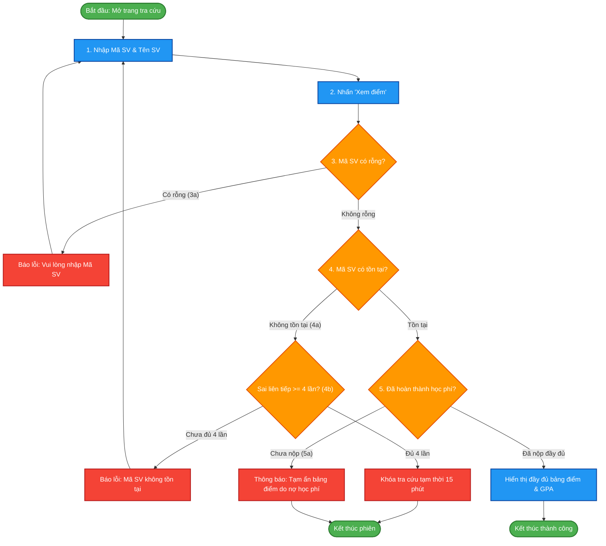
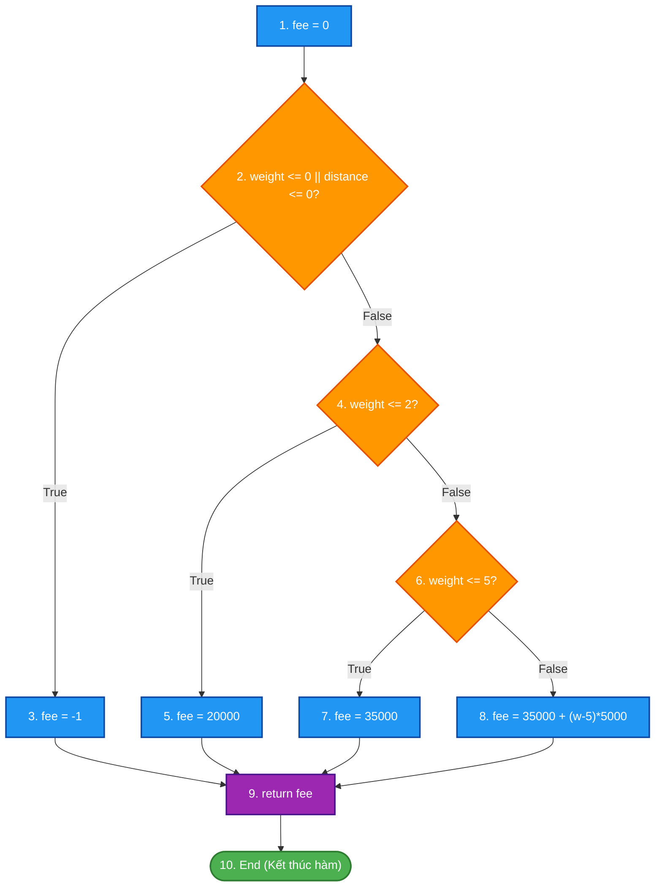
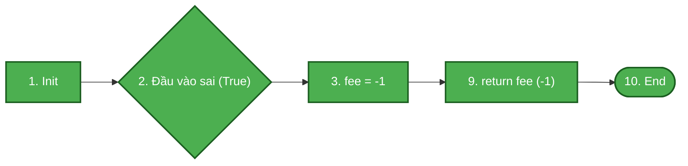
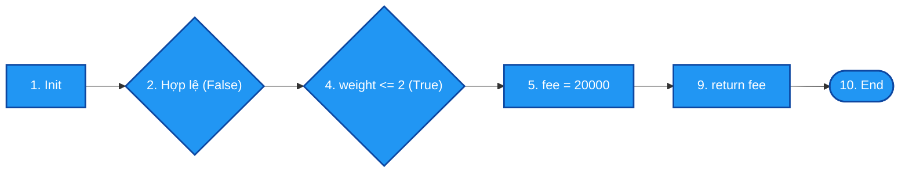
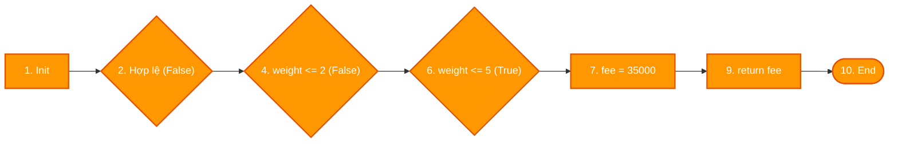
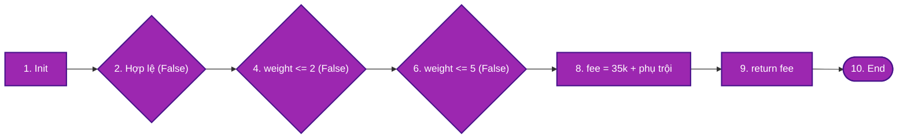

# ĐỀ THI KẾT THÚC HỌC PHẦN: KIỂM THỬ PHẦN MỀM
**Mã đề thi:** KB3_De03  
**Thời gian làm bài:** 60 – 75 phút *(Không sử dụng tài liệu)*  
**Hình thức:** Tự luận trên giấy / nộp bài giải chi tiết  
**Cấu trúc điểm:** Câu 1 (6.0 điểm) + Câu 2 (4.0 điểm) = 10.0 điểm  

---

## CÂU 1: KIỂM THỬ HỘP ĐEN – KỸ THUẬT KIỂM THỬ THEO CA SỬ DỤNG (USE CASE TESTING) (6.0 điểm)

Trong Hệ thống Quản lý đào tạo của trường đại học, xét ca sử dụng **"Xem điểm học tập của sinh viên" (Show Student Marks)** được đặc tả nghiệp vụ như sau:

- **Tên ca sử dụng:** Xem điểm học tập của sinh viên (Show Student Marks)
- **Tác nhân (Actors):** Sinh viên, Giảng viên cố vấn, Phụ huynh
- **Điều kiện tiên quyết (Preconditions):**
  1. Người dùng đã truy cập cổng thông tin sinh viên và hệ thống kết nối mạng ổn định.
  2. Người dùng có Mã sinh viên (Student ID) hợp lệ cần tra cứu.
- **Kịch bản chính (Basic Flow / Luồng chuẩn):**
  1. Người dùng nhập Tên sinh viên và Mã sinh viên (Student ID).
  2. Người dùng nhấn nút "Xem điểm".
  3. Hệ thống kiểm tra tính hợp lệ của thông tin đầu vào.
  4. Hệ thống truy vấn dữ liệu điểm thi từ cơ sở dữ liệu.
  5. Hệ thống hiển thị đầy đủ bảng điểm các môn học cùng điểm trung bình tích lũy (GPA).
- **Các luồng mở rộng và ngoại lệ (Extensions / Alternative & Exception Flows):**
  - **3a. Thông tin để trống:** Người dùng không nhập Mã sinh viên $\to$ Hệ thống hiển thị thông báo lỗi *"Vui lòng nhập Mã sinh viên"* và dừng lại ở bước 1.
  - **4a. Mã sinh viên không tồn tại:** Hệ thống không tìm thấy hồ sơ sinh viên $\to$ Hiển thị thông báo *"Mã sinh viên không tồn tại trên hệ thống"*.
  - **4b. Nhập sai mã sinh viên 4 lần liên tiếp:** Hệ thống hiển thị cảnh báo vi phạm bảo mật và tự động khóa chức năng tra cứu tạm thời trong 15 phút.
  - **5a. Sinh viên chưa hoàn thành học phí:** Bảng điểm bị ẩn, hệ thống hiển thị thông báo *"Tài khoản chưa hoàn thành nghĩa vụ học phí, vui lòng liên hệ phòng Tài chính"*.

**Yêu cầu:**

1. *(1.5 điểm)* Vẽ **Sơ đồ luồng hoạt động (Activity Diagram / Use Case Flowchart)** thể hiện luồng chính và các luồng rẽ nhánh mở rộng bằng Mermaid.
2. *(1.5 điểm)* Xác định ma trận các **kịch bản kiểm thử (Test Scenarios)** bao phủ toàn bộ các đường rẽ nhánh từ đặc tả ca sử dụng trên.
3. *(2.0 điểm)* Thiết kế **Bảng ca kiểm thử theo ca sử dụng (Use Case Test Cases)** đầy đủ (ghi rõ Mã TC, Kịch bản kiểm thử, Điều kiện tiên quyết, Các bước thực hiện, Dữ liệu thử, Kết quả mong đợi).
4. *(1.0 điểm)* Trình bày ưu điểm và phạm vi áp dụng thực tế của kỹ thuật Kiểm thử theo ca sử dụng trong quy trình phát triển phần mềm.

---

## CÂU 2: KIỂM THỬ HỘP TRẮNG – PHƯƠNG PHÁP KIỂM THỬ ĐƯỜNG CƠ BẢN (4.0 điểm)

Cho hàm tính phí giao hàng `calculate_shipping_fee` viết bằng ngôn ngữ C như sau:

```c
int calculate_shipping_fee(int weight, int distance)
{
    int fee = 0;
    if (weight <= 0 || distance <= 0)
    {
        fee = -1; // Dữ liệu đầu vào không hợp lệ
    }
    else if (weight <= 2)
    {
        fee = 20000; // Mức kiện hàng nhẹ (<= 2kg)
    }
    else if (weight <= 5)
    {
        fee = 35000; // Mức kiện hàng vừa (<= 5kg)
    }
    else
    {
        fee = 35000 + (weight - 5) * 5000; // Kiện hàng nặng (> 5kg)
    }
    return fee;
}
```

**Yêu cầu:**

1. *(1.0 điểm)* Vẽ **Đồ thị luồng điều khiển (CFG)** của đoạn mã trên. Đánh số các nút rõ ràng.
2. *(1.0 điểm)* Tính độ phức tạp Cyclomatic $V(G)$ bằng hai công thức khác nhau.
3. *(1.0 điểm)* Liệt kê và sơ đồ hóa tập các **đường thi hành cơ sở (Basis Paths)** độc lập tuyến tính.
4. *(1.0 điểm)* Thiết kế bảng ca kiểm thử tương ứng cho từng đường thi hành (ghi rõ Mã TC, dữ liệu đầu vào `weight`, `distance`, vết luồng đi qua các nút, phí mong đợi `fee`).

---
### HẾT PHẦN ĐỀ BÀI
---

# LỜI GIẢI CHI TIẾT – ĐỀ 03 KỊCH BẢN 3

---

## CÂU 1 – LỜI GIẢI (6.0 điểm)

### 1. Sơ đồ luồng hoạt động của Ca sử dụng (1.5 điểm)



---

### 2. Xác định các kịch bản kiểm thử (Test Scenarios) (1.5 điểm)

Từ sơ đồ và đặc tả Use Case, phân tích thành 5 kịch bản kiểm thử bao phủ toàn bộ các đường rẽ nhánh:

| Mã kịch bản | Loại luồng | Tên kịch bản | Mục tiêu kiểm thử |
|:---:|:---|:---|:---|
| **SC01** | Basic Flow | Luồng chuẩn thành công | Nhập đúng Mã SV hợp lệ, đã nộp học phí $\to$ hiển thị bảng điểm |
| **SC02** | Extension 3a | Bỏ trống Mã sinh viên | Bỏ trống ô Mã SV $\to$ hệ thống cảnh báo yêu cầu nhập |
| **SC03** | Extension 4a | Mã sinh viên không tồn tại | Nhập mã SV không có trong CSDL (lần 1) $\to$ báo lỗi không tìm thấy |
| **SC04** | Extension 4b | Khóa tra cứu sau 4 lần sai | Nhập sai liên tiếp 4 lần $\to$ hệ thống khóa chức năng 15 phút |
| **SC05** | Extension 5a | Sinh viên chưa đóng học phí | Nhập mã SV có thực nhưng chưa đóng học phí $\to$ ẩn điểm, báo liên hệ tài chính |

---

### 3. Thiết kế bảng ca kiểm thử theo ca sử dụng (Use Case Test Cases) (2.0 điểm)

| TC ID | Kịch bản | Các bước thực hiện (Steps) | Dữ liệu đầu vào (Input) | Kết quả mong đợi (Expected Result) |
|:---:|:---|:---|:---|:---|
| **UC01** | SC01: Chuẩn thành công | 1. Nhập Mã SV & Tên SV.<br>2. Nhấn nút "Xem điểm". | Mã SV: `"SV202401"`<br>Tên: `"Nguyễn Văn A"` | Hiển thị bảng điểm các môn, điểm chữ, tín chỉ và GPA: 3.55 |
| **UC02** | SC02: Để trống mã | 1. Để trống ô Mã SV.<br>2. Nhấn nút "Xem điểm". | Mã SV: `""`<br>Tên: `"Nguyễn Văn A"` | Hệ thống hiển thị popup: *"Vui lòng nhập Mã sinh viên"*, con trỏ nhảy về ô Mã SV |
| **UC03** | SC03: Mã SV không tồn tại | 1. Nhập mã SV không tồn tại lần 1.<br>2. Nhấn nút "Xem điểm". | Mã SV: `"SV999999"`<br>Tên: `"Trần Văn B"` | Hiển thị thông báo: *"Mã sinh viên không tồn tại trên hệ thống"*. Cho phép nhập lại |
| **UC04** | SC04: Khóa sau 4 lần sai | 1. Nhập sai lần 1, 2, 3.<br>2. Tiếp tục nhập sai lần 4.<br>3. Nhấn "Xem điểm". | Mã SV: `"SV888888"`<br>Số lần thử: 4 | Hiển thị cảnh báo: *"Bạn đã nhập sai 4 lần. Tính năng tra cứu bị khóa 15 phút"*, nút "Xem điểm" bị vô hiệu hóa |
| **UC05** | SC05: Chưa đóng học phí | 1. Nhập mã SV hợp lệ nhưng nợ học phí.<br>2. Nhấn "Xem điểm". | Mã SV: `"SV202402"`<br>Tình trạng: Nợ học phí | Không hiển thị điểm. Thông báo: *"Tài khoản chưa hoàn thành nghĩa vụ học phí, vui lòng liên hệ phòng Tài chính"* |

---

### 4. Ưu điểm và phạm vi áp dụng của Kiểm thử theo ca sử dụng (1.0 điểm)
- **Ưu điểm vượt trội:**
  - Tiếp cận hệ thống từ góc nhìn người dùng thực tế (End-User Perspective).
  - Bao phủ toàn diện các kịch bản tương tác nghiệp vụ từ đầu đến cuối (End-to-End Testing).
  - Giúp phát hiện các lỗi liên kết dữ liệu giữa các thành phần/mô-đun và lỗi luồng logic nghiệp vụ.
- **Phạm vi áp dụng:**
  - Kiểm thử tích hợp hệ thống (System Integration Testing).
  - Kiểm thử mức hệ thống (System Testing).
  - Kiểm thử chấp nhận của người dùng (User Acceptance Testing - UAT).

---

## CÂU 2 – LỜI GIẢI (4.0 điểm)

### Bước 1: Đánh số câu lệnh và xác định các nút trong Đồ thị luồng điều khiển (CFG)

- **Nút 1:** `int fee = 0;` *(Khởi tạo phí ban đầu)*
- **Nút 2:** `if (weight <= 0 || distance <= 0)` *(Vị từ rẽ nhánh 1: kiểm tra dữ liệu không hợp lệ)*
- **Nút 3:** `fee = -1;` *(Gán mã lỗi)*
- **Nút 4:** `else if (weight <= 2)` *(Vị từ rẽ nhánh 2: kiện hàng nhẹ)*
- **Nút 5:** `fee = 20000;` *(Gán mức cước 20.000đ)*
- **Nút 6:** `else if (weight <= 5)` *(Vị từ rẽ nhánh 3: kiện hàng vừa)*
- **Nút 7:** `fee = 35000;` *(Gán mức cước 35.000đ)*
- **Nút 8:** `fee = 35000 + (weight - 5) * 5000;` *(Tính cước hàng nặng theo phụ trội)*
- **Nút 9:** `return fee;` *(Trả về tiền cước)*
- **Nút 10:** `End / Exit` *(Điểm kết thúc hàm)*

---

### Sơ đồ Đồ thị luồng điều khiển (CFG) tổng quát



---

### Bước 2: Tính độ phức tạp Cyclomatic $V(G)$

Thống kê các thành phần của đồ thị luồng điều khiển $G$:
- **Số nút ($N$):** $10$ (từ Nút 1 đến Nút 10)
- **Số cung ($E$):** $12$ gồm: $(1\to2)$, $(2\to3)$, $(2\to4)$, $(3\to9)$, $(4\to5)$, $(4\to6)$, $(5\to9)$, $(6\to7)$, $(6\to8)$, $(7\to9)$, $(8\to9)$, $(9\to10)$
- **Số nút vị từ phân nhánh ($P$):** $3$ nút điều kiện (Nút 2, Nút 4, Nút 6)

Áp dụng 2 công thức:
- **Công thức 1 (Theo số cung và số nút):**
  $$V(G) = E - N + 2 = 12 - 10 + 2 = 4$$
- **Công thức 2 (Theo số nút vị từ $P$):**
  $$V(G) = P + 1 = 3 + 1 = 4$$

*(Kiểm chứng theo số miền phẳng $R$: Đồ thị có 3 miền khép kín và 1 miền mở vô hạn bao quanh $\implies V(G) = R = 4$)*.

> **Kết luận:** Độ phức tạp Cyclomatic $V(G) = 4$. Cần tối thiểu **4 đường thi hành cơ sở (Basis Paths)** độc lập tuyến tính để bao phủ kiểm thử.

---

### Bước 3: Sơ đồ hóa từng đường thi hành cơ sở (Basis Paths)

#### 🔹 Đường 1 (P1): Dữ liệu không hợp lệ (`weight <= 0` hoặc `distance <= 0`)
- **Đường đi:** $1 \to 2(\text{True}) \to 3 \to 9 \to 10$
- **Đặc điểm:** Bao phủ nhánh `True` của Nút 2; gán `fee = -1`.



#### 🔹 Đường 2 (P2): Kiện hàng nhẹ ($0 < weight \le 2$ kg)
- **Đường đi:** $1 \to 2(\text{False}) \to 4(\text{True}) \to 5 \to 9 \to 10$
- **Đặc điểm:** Bao phủ nhánh `False` của Nút 2 và nhánh `True` của Nút 4; gán `fee = 20000`.



#### 🔹 Đường 3 (P3): Kiện hàng vừa ($2 < weight \le 5$ kg)
- **Đường đi:** $1 \to 2(\text{False}) \to 4(\text{False}) \to 6(\text{True}) \to 7 \to 9 \to 10$
- **Đặc điểm:** Bao phủ nhánh `False` của Nút 4 và nhánh `True` của Nút 6; gán `fee = 35000`.



#### 🔹 Đường 4 (P4): Kiện hàng nặng ($weight > 5$ kg)
- **Đường đi:** $1 \to 2(\text{False}) \to 4(\text{False}) \to 6(\text{False}) \to 8 \to 9 \to 10$
- **Đặc điểm:** Bao phủ nhánh `False` của cả Nút 4 và Nút 6; tính phụ trội $fee = 35000 + (w-5) \times 5000$.



---

### Bước 4: Ma trận bao phủ các cung (Branch / Edge Coverage Matrix)

| Cung (Edge) | Nhãn nhánh | P1 | P2 | P3 | P4 | Mức độ bao phủ |
|:---:|:---|:---:|:---:|:---:|:---:|:---:|
| **e1** ($1 \to 2$) | Khởi tạo vào kiểm tra hợp lệ | ✓ | ✓ | ✓ | ✓ | 100% |
| **e2** ($2 \to 3$) | Nhánh dữ liệu sai là True | ✓ | | | | 100% |
| **e3** ($2 \to 4$) | Nhánh dữ liệu sai là False | | ✓ | ✓ | ✓ | 100% |
| **e4** ($3 \to 9$) | Gán fee = -1 đến return | ✓ | | | | 100% |
| **e5** ($4 \to 5$) | Nhánh `weight <= 2` là True | | ✓ | | | 100% |
| **e6** ($4 \to 6$) | Nhánh `weight <= 2` là False | | | ✓ | ✓ | 100% |
| **e7** ($5 \to 9$) | Gán fee = 20k đến return | | ✓ | | | 100% |
| **e8** ($6 \to 7$) | Nhánh `weight <= 5` là True | | | ✓ | | 100% |
| **e9** ($6 \to 8$) | Nhánh `weight <= 5` là False | | | | ✓ | 100% |
| **e10** ($7 \to 9$) | Gán fee = 35k đến return | | | ✓ | | 100% |
| **e11** ($8 \to 9$) | Tính phụ trội đến return | | | | ✓ | 100% |
| **e12** ($9 \to 10$) | Trả về fee đến kết thúc hàm | ✓ | ✓ | ✓ | ✓ | 100% |

---

### Bước 5: Bảng ca kiểm thử hộp trắng (Basis Path Testing Test Cases)

| TC ID | Mục tiêu kiểm thử | `weight` | `distance` | Luồng thực thi qua các nút | Kết quả mong đợi (`fee`) | Tiêu chí bao phủ đạt được |
|:---:|:---|:---:|:---:|:---|:---:|:---|
| **TC_P1** | Phủ đường P1 (Trọng lượng $\le 0$) | 0 kg | 10 km | $1 \to 2(T) \to 3 \to 9 \to 10$ | `-1` (Lỗi) | Nhánh True Nút 2, câu lệnh Nút 3 |
| **TC_P2** | Phủ đường P2 (Kiện hàng nhẹ $\le 2$ kg) | 1.5 kg | 10 km | $1 \to 2(F) \to 4(T) \to 5 \to 9 \to 10$ | `20.000 VNĐ` | Nhánh True Nút 4, câu lệnh Nút 5 |
| **TC_P3** | Phủ đường P3 (Kiện hàng vừa $\le 5$ kg) | 4.0 kg | 10 km | $1 \to 2(F) \to 4(F) \to 6(T) \to 7 \to 9 \to 10$ | `35.000 VNĐ` | Nhánh True Nút 6, câu lệnh Nút 7 |
| **TC_P4** | Phủ đường P4 (Kiện hàng nặng $> 5$ kg) | 7.0 kg | 10 km | $1 \to 2(F) \to 4(F) \to 6(F) \to 8 \to 9 \to 10$ | `45.000 VNĐ`<br>*(35k + 2×5k)* | Nhánh False Nút 6, câu lệnh Nút 8 |

---

> **Tổng kết thang điểm đạt được:**
> - **Câu 1 (Kiểm thử theo ca sử dụng - Use Case):** 6.0 điểm – Sơ đồ luồng hoạt động chuẩn (1.5đ), ma trận 5 kịch bản (1.5đ), bảng 5 ca kiểm thử đầy đủ (2.0đ), phân tích ưu điểm/phạm vi (1.0đ).
> - **Câu 2 (Hộp trắng – Basis Path):** 4.0 điểm – CFG đúng (1đ), V(G)=4 bằng 2 công thức (1đ), 4 Basis Paths có sơ đồ minh họa trực quan (1đ), bảng TC đúng (1đ).
