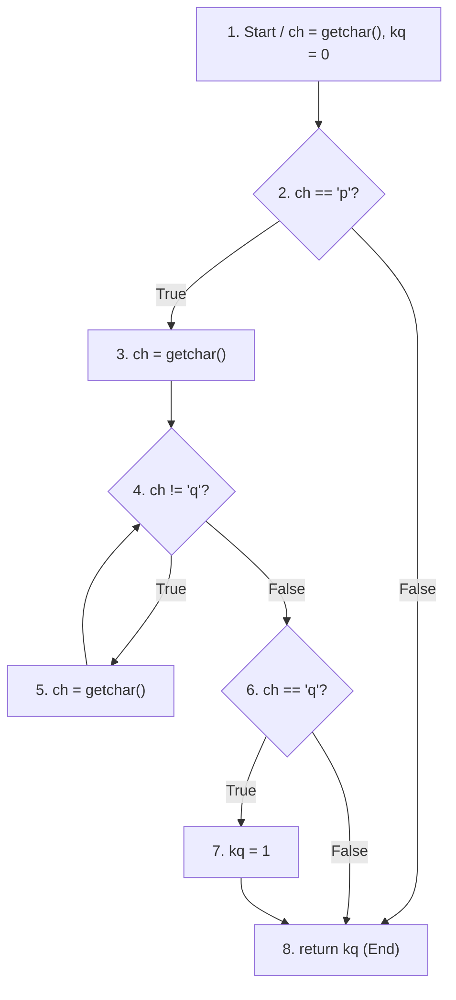

# TÀI LIỆU ÔN TẬP & PHÂN TÍCH MA TRẬN ĐỀ THI GIỮA KỲ

## MÔN: KIỂM THỬ PHẦN MỀM (SOFTWARE TESTING)

---

## MỤC LỤC

1. [Phân tích &amp; Đánh giá Đề 02 (Đề hiện có)](#1-phân-tích--đánh-giá-đề-02)
2. [Lời giải mẫu chi tiết cho Đề 02 (Đạt 10/10 điểm)](#2-lời-giải-chi-tiết-đề-02)
   - [Câu 1: Kiểm thử Hộp đen (6 điểm)](#câu-1-kiểm-thử-hộp-đen-6-điểm)
   - [Câu 2: Kiểm thử Hộp trắng (4 điểm)](#câu-2-kiểm-thử-hộp-trắng-4-điểm)
3. [Dự đoán số lượng &amp; Ma trận 3 Đề còn lại](#3-dự-đoán-3-đề-còn-lại)
   - [Kịch bản 1: Giữ nguyên kỹ thuật - Đổi kịch bản &amp; Hàm mã nguồn](#kịch-bản-1-giữ-nguyên-kỹ-thuật)
   - [Kịch bản 2: Xoay vòng kỹ thuật kiểm thử trong Slide](#kịch-bản-2-xoay-vòng-kỹ-thuật)
4. [Bộ đề dự đoán và Hướng dẫn giải các dạng bài trọng tâm](#4-bộ-đề-dự-đoán-trọng-tâm)
   - [Dạng Hộp đen: Bảng quyết định (Decision Table)](#dạng-bảng-quyết-định-decision-table)
   - [Dạng Hộp trắng: Kiểm thử đường cơ bản (Basis Path Testing)](#dạng-kiểm-thử-đường-cơ-bản-basis-path-testing)
5. [Bí quyết &amp; Mẹo trình bày ăn trọn điểm](#5-bí-quyết-trình-bày-ăn-trọn-điểm)

---

<a name="1-phân-tích--đánh-giá-đề-02"></a>

## 1. PHÂN TÍCH & ĐÁNH GIÁ ĐỀ 02

* **Tổng quan cấu trúc:** Đề gồm 2 câu, chuẩn ma trận thi giữa kỳ:
  * **Câu 1 (6 điểm):** Kiểm thử hộp đen (Black-box testing) – gồm Lớp tương đương (3đ) và Giá trị biên (3đ).
  * **Câu 2 (4 điểm):** Kiểm thử hộp trắng (White-box testing) – Bao phủ đường thi hành (Path coverage).
* **Đánh giá độ khó:** Mức độ **Trung bình - Khá**. Đề không đánh đố nhưng có các điểm "bẫy" dễ mất điểm:
  * *Bẫy Hộp đen:* Bài toán khu bơi có **2 biến đầu vào** gồm `Độ tuổi` và `Có người lớn đi kèm hay không` (đối với trẻ $< 6$ tuổi). Nếu sinh viên chỉ chia lớp theo mỗi biến `Tuổi` thì sẽ bị mất nửa số điểm vì thiếu điều kiện đi kèm.
  * *Bẫy Hộp trắng:* Đoạn code chứa vòng lặp `while (ch != 'q')` lồng trong `if (ch == 'p')`. Nếu không hiểu bản chất vòng lặp, sinh viên sẽ không liệt kê hết các đường thi hành tiêu biểu (lặp 0 lần, lặp $\ge 1$ lần, không thỏa mãn điều kiện kết thúc). Đoạn code này được chuyển thể trực tiếp từ bài tập mẫu trên Slide Chương 3 buổi 3 (`check_d_after_e()`).

---

<a name="2-lời-giải-chi-tiết-đề-02"></a>

## 2. LỜI GIẢI CHI TIẾT ĐỀ 02 (CHUẨN FORM CHẤM ĐIỂM)

### Câu 1: Kiểm thử Hộp đen (6 điểm)

#### Đặc tả bài toán:

* **Quy định vào khu vực bơi:**
  * Trẻ $< 6$ tuổi: Bắt buộc phải có người lớn đi kèm (nếu không có thì không được vào).
  * Trẻ từ $6$ đến $12$ tuổi: Tự do vào khu bơi thiếu nhi (không bắt buộc người lớn).
  * Trẻ $> 12$ tuổi: Không được vào khu thiếu nhi, chuyển sang khu người lớn.
* **Quy định giá vé:**
  * Trẻ $< 6$ tuổi: Miễn phí vé trẻ em, nhưng người lớn đi kèm phải mua vé $50.000$ VNĐ.
  * Trẻ $6 - 12$ tuổi: Vé $30.000$ VNĐ.
  * Người $> 12$ tuổi: Vé $50.000$ VNĐ.
* **Xác định các biến đầu vào:**
  1. $X$: Độ tuổi (Số nguyên dương, quy ước $0 \le X \le 120$).
  2. $Y$: Có người lớn đi kèm không (Logic: Có / Không - áp dụng khi $X < 6$).

---

#### a. Áp dụng kỹ thuật kiểm thử lớp tương đương (3 điểm)

##### Bước 1: Xác định và phân loại các lớp tương đương

| Biến đầu vào                                                | Lớp tương đương hợp lệ                                                                                                                                       | Lớp tương đương không hợp lệ                                                                                                                  |
| :-------------------------------------------------------------- | :------------------------------------------------------------------------------------------------------------------------------------------------------------------- | :----------------------------------------------------------------------------------------------------------------------------------------------------- |
| **Độ tuổi ($X$)**                                    | • **EC1:** $0 \le X < 6$ (Trẻ dưới 6 tuổi)• **EC2:** $6 \le X \le 12$ (Trẻ từ 6 đến 12 tuổi)• **EC3:** $X > 12$ (Trên 12 tuổi) | • **EC4:** $X < 0$ (Tuổi âm)• **EC5:** $X > 120$ (Tuổi không thực tế)• **EC6:** $X$ không phải số (ký tự/trống) |
| **Người lớn đi kèm ($Y$)** *(áp dụng cho EC1)* | • **EC7:** Có người lớn đi kèm (`Yes`)• **EC8:** Không có người lớn đi kèm (`No`)                                                     | • **EC9:** Dữ liệu trống / sai định dạng                                                                                                  |

##### Bước 2: Thiết kế các ca kiểm thử (Test Cases)

|  Test Case ID  | Mục đích kiểm thử                       | Dữ liệu đầu vào (Tuổi $X$, Kèm $Y$) | Phân loại lớp bao phủ | Kết quả mong đợi                                                        |
| :------------: | :------------------------------------------- | :--------------------------------------------- | :-----------------------: | :-------------------------------------------------------------------------- |
| **TC01** | Trẻ dưới 6 tuổi, có người lớn kèm   | Tuổi = 4, Đi kèm = Có                      |         EC1, EC7         | Cho phép vào khu thiếu nhi; Vé trẻ em: 0đ; Vé người lớn: 50.000đ |
| **TC02** | Trẻ dưới 6 tuổi, không có người lớn | Tuổi = 3, Đi kèm = Không                   |         EC1, EC8         | **Từ chối vào cửa**, thông báo cần người lớn đi kèm       |
| **TC03** | Trẻ từ 6 đến 12 tuổi                    | Tuổi = 9, Đi kèm = Không                   |            EC2            | Cho phép vào khu thiếu nhi; Vé: 30.000đ                                |
| **TC04** | Người trên 12 tuổi                       | Tuổi = 16, Đi kèm = Không                  |            EC3            | Chuyển sang khu người lớn; Vé: 50.000đ                                |
| **TC05** | Tuổi âm (Không hợp lệ)                  | Tuổi = -2                                     |            EC4            | Báo lỗi: "Độ tuổi không hợp lệ"                                     |
| **TC06** | Tuổi quá lớn (Không hợp lệ)            | Tuổi = 150                                    |            EC5            | Báo lỗi: "Độ tuổi vượt quá giới hạn"                              |
| **TC07** | Nhập chữ/ký tự đặc biệt               | Tuổi = "abc"                                  |            EC6            | Báo lỗi: "Vui lòng nhập số nguyên"                                    |

---

#### b. Áp dụng kỹ thuật kiểm thử giá trị biên (3 điểm)

##### Bước 1: Xác định các giá trị biên

Xét trường giá trị hợp lệ của độ tuổi $X \in [0, 120]$ với các điểm biên phân chia: $0$, $6$, $12$, $120$.

* **Biên 0 tuổi:** Giá trị biên là $\{-1, 0, 1\}$
* **Biên 6 tuổi:** Phân định giữa $<6$ và $\ge 6 \implies$ Giá trị biên là $\{5, 6, 7\}$
* **Biên 12 tuổi:** Phân định giữa $\le 12$ và $> 12 \implies$ Giá trị biên là $\{11, 12, 13\}$
* **Biên 120 tuổi:** Giá trị biên là $\{119, 120, 121\}$

##### Bước 2: Thiết kế bảng ca kiểm thử giá trị biên (BVA Test Cases)

|      TC ID      | Giá trị kiểm tra                      | Tuổi ($X$) | Người kèm ($Y$) | Kết quả mong đợi                                               |
| :-------------: | :--------------------------------------- | :-----------: | :------------------: | :----------------------------------------------------------------- |
| **BVA01** | Dưới biên tối thiểu ($0 - 1$)     |      -1      |        Không        | Báo lỗi: Tuổi không hợp lệ                                   |
| **BVA02** | Biên tối thiểu ($0$)                |       0       |         Có         | Miễn phí trẻ em, vé người kèm 50.000đ, vào khu thiếu nhi |
| **BVA03** | Ngay trên biên tối thiểu ($0 + 1$) |       1       |         Có         | Miễn phí trẻ em, vé người kèm 50.000đ, vào khu thiếu nhi |
| **BVA04** | Ngay dưới biên 6 tuổi ($6 - 1$)    |       5       |         Có         | Miễn phí trẻ em, vé người kèm 50.000đ, vào khu thiếu nhi |
| **BVA05** | Ngay dưới biên 6 tuổi, không kèm   |       5       |        Không        | Báo lỗi / Từ chối vào cửa                                    |
| **BVA06** | Tại biên 6 tuổi ($6$)               |       6       |        Không        | Tự vào khu thiếu nhi, vé 30.000đ                              |
| **BVA07** | Ngay trên biên 6 tuổi ($6 + 1$)     |       7       |        Không        | Tự vào khu thiếu nhi, vé 30.000đ                              |
| **BVA08** | Ngay dưới biên 12 tuổi ($12 - 1$)  |      11      |        Không        | Vào khu thiếu nhi, vé 30.000đ                                  |
| **BVA09** | Tại biên 12 tuổi ($12$)             |      12      |        Không        | Vào khu thiếu nhi, vé 30.000đ                                  |
| **BVA10** | Ngay trên biên 12 tuổi ($12 + 1$)   |      13      |        Không        | Chuyển sang khu người lớn, vé 50.000đ                        |
| **BVA11** | Tại biên tối đa ($120$)            |      120      |        Không        | Chuyển sang khu người lớn, vé 50.000đ                        |
| **BVA12** | Vượt biên tối đa ($120 + 1$)      |      121      |        Không        | Báo lỗi: Tuổi vượt quá giới hạn                            |

---

### Câu 2: Kiểm thử Hộp trắng (4 điểm)

#### Mã nguồn:

```c
int check_p_q()
{
    char ch;
    int kq = 0;
    ch = getchar();
    if (ch == 'p')
    {
        ch = getchar();
        while (ch != 'q')
            ch = getchar();
        if (ch == 'q')
            kq = 1;
    }
    return kq;
}
```

#### Bước 1: Đánh số câu lệnh và xác định các nút đồ thị (CFG)

* **Nút 1:** `char ch; int kq = 0; ch = getchar();`
* **Nút 2:** `if (ch == 'p')` *(Kiểm tra điều kiện if 1)*
* **Nút 3:** `ch = getchar();` *(Bên trong if 1)*
* **Nút 4:** `while (ch != 'q')` *(Kiểm tra điều kiện vòng lặp while)*
* **Nút 5:** `ch = getchar();` *(Thân vòng lặp while)*
* **Nút 6:** `if (ch == 'q')` *(Kiểm tra sau while)*
* **Nút 7:** `kq = 1;`
* **Nút 8:** `return kq;` *(Điểm ra của hàm)*



#### Bước 2: Tính độ phức tạp Cyclomatic $V(G)$

* Số nút ($N$): $8$
* Số cung ($E$): $10$
* Số nút vị từ phân nhánh (Predicate nodes - $P$): $3$ (Nút 2, Nút 4, Nút 6)
* **Công thức 1:** $V(G) = E - N + 2 = 10 - 8 + 2 = 4$
* **Công thức 2:** $V(G) = P + 1 = 3 + 1 = 4$
* $\implies$ Cần ít nhất 4 ca kiểm thử đại diện cho các đường thi hành cơ sở.

#### Bước 3: Thiết kế ca kiểm thử thỏa mãn tiêu chí Bao phủ đường thi hành (Path Coverage)

Do có vòng lặp `while`, theo kỹ thuật kiểm thử vòng lặp, ta bao phủ các đường đặc trưng:

1. **Đường 1 (Không vào `if`):** `1 -> 2(False) -> 8`
2. **Đường 2 (Vào `if`, không lặp `while` - 0 lần lặp):** `1 -> 2(True) -> 3 -> 4(False) -> 6(True) -> 7 -> 8`
3. **Đường 3 (Vào `if`, lặp `while` $\ge 1$ lần):** `1 -> 2(True) -> 3 -> 4(True) -> 5 -> 4(False) -> 6(True) -> 7 -> 8`
4. **Đường 4 (Vào `if`, kết thúc không thấy `'q'` - chuỗi hết / EOF):** `1 -> 2(True) -> 3 -> 4(True) -> 5 -> ... -> 6(False) -> 8`

##### Bảng ca kiểm thử (Path Coverage Test Cases):

|    Test Case    |       Chuỗi nhập vào       | Luồng thực thi qua các nút                                     | Số lần lặp While | Giá trị trả về (`kq`) |                      Kết luận                      |
| :-------------: | :---------------------------: | :----------------------------------------------------------------- | :-----------------: | :-------------------------: | :--------------------------------------------------: |
| **TC_P1** |            `"a"`            | $1 \to 2(F) \to 8$                                               |          0          |              0              |      Bao phủ nhánh False của `if(ch=='p')`      |
| **TC_P2** |           `"pq"`           | $1 \to 2(T) \to 3 \to 4(F) \to 6(T) \to 7 \to 8$                 |          0          |              1              |         Ký tự sau `'p'` là `'q'` ngay         |
| **TC_P3** |           `"pxq"`           | $1 \to 2(T) \to 3 \to 4(T) \to 5 \to 4(F) \to 6(T) \to 7 \to 8$  |          1          |              1              | Ký tự sau `'p'` là chuỗi có `'q'` phía sau |
| **TC_P4** | `"p"` *(hết chuỗi/EOF)* | $1 \to 2(T) \to 3 \to 4(F) \to 6(F) \to 8$ *(với EOF != 'q')* |          0          |              0              |              Không có ký tự `'q'`              |

---

<a name="3-dự-đoán-3-đề-còn-lại"></a>

## 3. DỰ ĐOÁN 3 ĐỀ THI CÒN LẠI (ĐỀ 01, ĐỀ 03, ĐỀ 04)

Trong một phòng thi thường chia 4 đề xen kẽ ($A, B, C, D \equiv Đề 01, Đề 02, Đề 03, Đề 04$). Giảng viên ra đề theo 2 kịch bản sau:

<a name="kịch-bản-1-giữ-nguyên-kỹ-thuật"></a>

### Kịch bản 1: Giữ nguyên khung kỹ thuật - Đổi kịch bản & Hàm code (Xác suất 60%)

* **Khung đề chung:**
  * **Câu 1 (6đ):** Lớp tương đương (3đ) + Giá trị biên (3đ).
  * **Câu 2 (4đ):** Vẽ CFG + Bao phủ đường thi hành (Path Coverage) / Đường cơ bản (Basis Path Testing).

#### Các đề dự kiến:

* **Đề 01:**
  * *Câu 1:* Bài toán **Hệ thống đặt phòng khách sạn trực tuyến** (Slide P56):
    * Số đêm lưu trú: $1 \le \text{đêm} \le 30$.
    * Số lượng khách: $1 \le \text{người} \le 4$.
    * Yêu cầu: Xác định lớp tương đương & giá trị biên cho 2 biến `số đêm` và `số khách`.
  * *Câu 2:* Hàm tìm kiếm nhị phân `Binsearch(int X, int V[], int n)` (Slide P59) hoặc hàm gốc `check_d_after_e()` (Slide P58).
* **Đề 03:**
  * *Câu 1:* Bài toán **Tính cước vận chuyển hoặc Phí giao dịch ngân hàng** (Slide P53):
    * Số tiền giao dịch $< 1$ triệu: phí 5.000đ; từ $1 - 10$ triệu: phí 10.000đ; $> 10$ triệu: phí 0.1%.
  * *Câu 2:* Hàm tính phí ship `calculate(int amount)` (Slide P61) gồm chuỗi điều kiện lồng nhau.
* **Đề 04:**
  * *Câu 1:* Bài toán **Quy định độ tuổi đăng ký diễn đàn** (Slide P55):
    * Tuổi tối thiểu: $13$, tuổi tối đa: $99$.
  * *Câu 2:* Hàm `GetMaxDay(int month, int day, int year)` kiểm tra số ngày trong tháng và năm nhuận (Slide P62).

---

<a name="kịch-bản-2-xoay-vòng-kỹ-thuật"></a>

### Kịch bản 2: Xoay vòng kỹ thuật kiểm thử trong Slide (Xác suất 40%)

Để kiểm tra đa dạng kiến thức giữa các ca thi, giảng viên sẽ thay đổi kỹ thuật ở Câu 1 hoặc Câu 2:

|             Mã đề             | Câu 1: Kiểm thử Hộp đen (6 điểm)                                                                                              | Câu 2: Kiểm thử Hộp trắng (4 điểm)                                                                                               |
| :------------------------------: | :----------------------------------------------------------------------------------------------------------------------------------- | :-------------------------------------------------------------------------------------------------------------------------------------- |
|        **ĐỀ 01**        | **Bảng quyết định (Decision Table Testing)***(Bài Học bổng sinh viên ABX hoặc Bài Vé & Mũ tham quan bảo tàng)* | **Bao phủ nhánh & Điều kiện (Branch & Condition Coverage)***(Đoạn code có biểu thức `if (A \|\| B && C)`)*            |
| **ĐỀ 02** *(Đã có)* | **Lớp tương đương (3đ) + Giá trị biên (3đ)***(Bể bơi khu giải trí)*                                           | **Bao phủ đường thi hành (Path Coverage)***(Hàm `check_p_q`)*                                                           |
|        **ĐỀ 03**        | **Bảng quyết định (Decision Table Testing)***(Phần mềm xét hạn mức tín dụng / cầm cố nhà)*                     | **Kiểm thử đường cơ bản (Basis Path Testing - McCabe)***(Tính $V(G)$, tìm tập đường độc lập, lập test case)* |
|        **ĐỀ 04**        | **Lớp tương đương + Giá trị biên***(Bài Vé xe điện giờ cao điểm / Đặt phòng khách sạn)*                 | **Bao phủ câu lệnh (Statement Coverage) + Bao phủ quyết định (Decision Coverage)**                                         |

---

<a name="4-bộ-đề-dự-đoán-trọng-tâm"></a>

## 4. BỘ ĐỀ DỰ ĐOÁN VÀ HƯỚNG DẪN GIẢI CÁC DẠNG BÀI TRỌNG TÂM

<a name="dạng-bảng-quyết-định-decision-table"></a>

### Dạng 1: Kiểm thử Hộp đen bằng BẢNG QUYẾT ĐỊNH (Decision Table)

> Đây là kỹ thuật có khả năng ra thi cực cao ở Đề 01 hoặc Đề 03 nếu đổi kỹ thuật.

#### Đề bài mẫu (Trích Slide P88):

Quản lý tiền vé và phát mũ tại bảo tàng:

* **Giá vé:**
  * Trẻ em $< 5$ tuổi: Miễn phí ($0\$$).
  * Từ $5$ đến $65$ tuổi: $20\$$ / vé.
  * $> 65$ tuổi: $10\$$ / vé.
* **Tặng mũ:**
  * Khách Nữ: Tặng mũ màu Hồng.
  * Khách Nam: Tặng mũ màu Xanh.

#### Lời giải chuẩn:

* **Các điều kiện (Conditions):**
  * $C_1$: Độ tuổi ($<5$, $5-65$, $>65$)
  * $C_2$: Giới tính (Nam, Nữ)
* **Các hành động (Actions):**
  * $A_1$: Vé 0\$
  * $A_2$: Vé 20\$
  * $A_3$: Vé 10\$
  * $A_4$: Mũ Hồng
  * $A_5$: Mũ Xanh

**Bảng quyết định (Decision Table):**

| Điều kiện / Hành động | R1 | R2 | R3 | R4 | R5 | R6 |
| :-------------------------- | :-: | :-: | :-: | :-: | :-: | :-: |
| **Tuổi $< 5$**     |  T  |  T  |  F  |  F  |  F  |  F  |
| **Tuổi $5 - 65$**  |  F  |  F  |  T  |  T  |  F  |  F  |
| **Tuổi $> 65$**    |  F  |  F  |  F  |  F  |  T  |  T  |
| **Giới tính**       | Nữ | Nam | Nữ | Nam | Nữ | Nam |
| **Vé 0\$**           |  X  |  X  |    |    |    |    |
| **Vé 20\$**          |    |    |  X  |  X  |    |    |
| **Vé 10\$**          |    |    |    |    |  X  |  X  |
| **Mũ Hồng**         |  X  |    |  X  |    |  X  |    |
| **Mũ Xanh**          |    |  X  |    |  X  |    |  X  |

$\implies$ Thiết kế tương ứng 6 Test Cases cho 6 quy tắc (R1 đến R6).

---

<a name="dạng-kiểm-thử-đường-cơ-bản-basis-path-testing"></a>

### Dạng 2: Kiểm thử Hộp trắng bằng KIỂM THỬ ĐƯỜNG CƠ BẢN (Basis Path Testing)

#### Các bước làm bài chuẩn:

1. **Bước 1:** Vẽ Đồ thị luồng điều khiển (CFG).
2. **Bước 2:** Tính độ phức tạp Cyclomatic $V(G) = E - N + 2 = P + 1$.
3. **Bước 3:** Liệt kê tập đường cơ bản (gồm đúng $V(G)$ đường độc lập tuyến tính, mỗi đường mới phải chứa ít nhất 1 cung chưa từng đi qua).
4. **Bước 4:** Lập bảng Test Case (chỉ rõ Input, Output kỳ vọng cho từng đường).

---

<a name="5-bí-quyết-trình-bày-ăn-trọn-điểm"></a>

## 5. BÍ QUYẾT TRÌNH BÀY ĂN TRỌN ĐIỂM KHI ĐI THI

1. **Phần Hộp đen:**
   * Luôn viết rõ: **Xác định các biến đầu vào** trước khi chia bảng.
   * Lập bảng có đủ các cột: `Mã ca (TC ID)`, `Mô tả`, `Dữ liệu vào (Input)`, `Lớp bao phủ`, `Kết quả mong đợi (Expected Result)`.
   * Đối với giá trị biên, nên chỉ rõ quy ước đang dùng (Biên 2 giá trị hay Biên 3 giá trị).
2. **Phần Hộp trắng:**
   * Đánh số thứ tự các dòng lệnh trực tiếp trên đề thi để làm tên nút đồ thị.
   * Vẽ CFG sạch sẽ, có mũi tên chỉ hướng luồng đi rõ ràng, chú thích nhãn `True` / `False` ở các nút phân nhánh.
   * Viết rõ cả 2 công thức tính độ phức tạp Cyclomatic $V(G)$ để chứng minh kết quả là chính xác.
